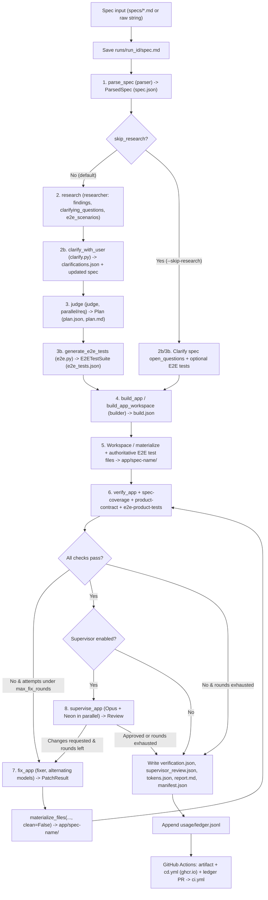

# Atlas Architecture

This document explains how Atlas orchestrates LLM calls, turns a written or typed specification into a verified product inside `app/<spec-name>/`, and how to extend roles such as `builder` and `fixer` with reusable skills.

---

## 1. Orchestration Model (Plain Async Python, Not LangChain/LangGraph)

Atlas **does not use LangChain or LangGraph**.

Per [ADR 0001: Plain Python pipeline in Phase 1](docs/decisions/0001-phase1-plain-python.md), orchestration is implemented directly with standard Python `asyncio`, strict `Pydantic` v2 models, and `LiteLLM`:

- **Orchestrator ([`src/atlas/runner.py`](src/atlas/runner.py)):** `run_plan` and `run_build` are plain `async` functions that call each pipeline stage in sequence, manage artifacts under `runs/<run-id>/`, and drive the build/verify/fix loop.
- **Typed State Contracts ([`src/atlas/schemas.py`](src/atlas/schemas.py)):** Every stage communicates via strict `Pydantic` (`StrictModel`, `extra="forbid"`) schemas — `ParsedSpec`, `ResearchReport`, `Plan`, `GeneratedApp`, `PatchResult`, and `VerificationReport`.
- **Unified LLM & Harness Router ([`src/atlas/router.py`](src/atlas/router.py)):** `ModelRouter` wraps `litellm.acompletion` across cloud providers ([`config/models.yaml`](config/models.yaml)) and dispatches harness-backed roles (`antigravity` CLI, `claude_code` read-only CLI, and local `antigravity_sdk` via [`config/harness.yaml`](config/harness.yaml)), enforcing concurrency caps, output token limits, timeouts, budgets, key fallbacks, skills allowlists, and token/cost logging.

**Why this choice:** Keeping orchestration in plain Python makes execution paths, failure modes, and exact token spend transparent with minimal dependencies. At the same time, each stage function and Pydantic schema is cleanly decoupled so it can map 1:1 to LangGraph nodes if multi-turn agent loops, persistent checkpoints, or human-in-the-loop pause/resume are added in a later phase (see [ROADMAP.md](ROADMAP.md)).

---

## 2. End-to-End Flow: Spec Input to `app/<spec-name>/`

### Markdown File vs. Typed / Interactive Spec Input

Today, the CLI commands `atlas plan <spec.md>` and `atlas build <spec.md>` (or `atlas run <spec.md>`) ([`src/atlas/cli.py`](src/atlas/cli.py)) take a path to a Markdown file (for example [`specs/example-app.md`](specs/example-app.md)), read `raw_spec` from disk in `run_plan` / `run_build`, and immediately snapshot a copy to `runs/<run-id>/spec.md`.

Because every downstream stage works solely from that `raw_spec` string and `ParsedSpec`, supporting a spec typed directly in a CLI prompt, web UI, or API only requires saving that text to a temporary/run `.md` file (or passing the string directly into `parse_spec(router, raw_spec)`). No changes to the `research`, `judge`, `build`, or `verify` stages are needed.

### Stage-by-Stage Breakdown

| Stage | Module & Function | Role in config | Concurrency | Input | Validated Output | Artifacts Saved |
| :--- | :--- | :--- | :--- | :--- | :--- | :--- |
| **1. Parse** | [`parse_spec`](src/atlas/pipeline/parse.py) | `parser` | 1 call | Raw Markdown spec (`raw_spec`) | `ParsedSpec` (requirements DAG checked for cycles/unknown IDs) | `spec.md`, `spec.json` |
| **2. Research** *(optional)* | [`research`](src/atlas/pipeline/research.py) | `researcher` | Parallel across `(requirement x model)` bounded by `max_parallel` | `ParsedSpec` context + single `Requirement` | `ResearchNote` (with `clarifying_questions` & `e2e_scenarios`) + `ResearchFailure` | `research.json` |
| **2b. Clarify** *(automatic when questions exist)* | [`clarify_with_user`](src/atlas/pipeline/clarify.py) | *(Human TTY / `--answers` / non-TTY no-block)* | Interactive or prefilled | `spec.open_questions` + `research.clarifying_questions` | `ClarificationReport` -> answered Q&As folded into `ParsedSpec.assumptions` | `clarifications.json`, updated `spec.json` |
| **3. Judge** *(optional)* | [`judge`](src/atlas/pipeline/judge.py) | `judge` | Parallel per requirement (`asyncio.gather`) | Project overview + clarified `Requirement` + its filtered research notes | 1 `ToolDecision` (2–3 options + pick) per requirement -> assembled `Plan` + SHA-256 hash | `plan.json`, `plan.md` |
| **3b. E2E Test Gen** *(when enabled)* | [`generate_e2e_tests`](src/atlas/pipeline/e2e.py) | `e2e` / `researcher` | 1 call | Clarified `ParsedSpec`, `ClarificationReport`, `ResearchReport`, optional `Plan` (`config/harness.yaml` uses read-only `claude_code` `sonnet` with `--effort high`, fallback OpenRouter) | `E2ETestSuite` (`product_interface` contract, `verifiable`/`unverifiable_reason`, pre-seeded test files) | `e2e_tests.json`; `PLAN.md` + `tests/` pre-seeded into `app/<spec-name>/` before local builds |
| **4. Build** | [`build_app`](src/atlas/pipeline/build.py) / [`build_app_workspace`](src/atlas/pipeline/build.py) | `builder` | 1 session/call (+ offload) | Compact spec/contract + on-disk `PLAN.md`, `BUILD_BRIEF.md` (local builder), `tests/`, & `.agents/skills/` index (`discovery_mode: progressive`) | `GeneratedApp` or `WorkspaceBuildResult` (path & git-escape guarded; E2E files re-verified afterward). A `local_harness` builder that can't finish (no ready model, error, timeout, stall, nothing written) hands the build to its `offload` targets in order (`claude_code` Sonnet workspace harness with file-only tools `Read,Grep,Glob,Edit,Write`, then `agy` Hydrogen workspace harness, then OpenRouter on error) | `build.json`, files in `app/<spec-name>/`, `build_offloaded_to` / `build_offload_harness` in the manifest |
| **5. Verify** | [`verify_app`](src/atlas/pipeline/verify.py) + `spec-coverage` + `product-contract` + `e2e-product-tests` | *(No LLM call)* | Subprocesses in stripped env | Files inside `app/<spec-name>/` + functional IDs + expected E2E test paths | `CheckResult` list (compile, tests, lint/build, coverage, hygiene, E2E test integrity) | Recorded in `VerificationRound` |
| **6. Fix Loop** *(up to `max_fix_rounds`)* | [`fix_app`](src/atlas/pipeline/build.py) | `fixer` | 1 call per failed round (supports `rotate` across OpenRouter models or harness targets) | `ParsedSpec`, optional `Plan`, failing checks/review, `previous_diagnoses`, file snapshot (`config/harness.yaml` rotates `claude_code` Sonnet ↔ `agy` Hydrogen with OpenRouter error fallback) | `PatchResult` (`diagnosis`, `files`, `delete_files`) -> incremental `materialize_files` | Re-runs Step 5 after each patch |
| **7. Supervisor** *(optional, post-build)* | [`supervise_app`](src/atlas/pipeline/build.py) + [`merge_supervisor_reviews`](src/atlas/pipeline/build.py) | `supervisor` | Parallel across `backends.supervisor.reviewers` (`opus` + `neon`) | `ParsedSpec`, `Plan`, passing `VerificationRound`, read-only workspace / `current_files` | Unified `Review` (`approved`, `summary`, merged `issues` & `improvement_plan`, `reviewers`) | `supervisor_review.json`; rejections feed into Step 6 |
| **8. Reporting** | [`summarize_usage`](src/atlas/telemetry.py), [`render_run_report`](src/atlas/pipeline/render.py) | *(No LLM call)* | Always runs (`finally` block) | `router.call_log`, `VerificationReport`, optional `Review` | `TokenUsageSummary` (with `cost_source` & `unpriced_calls`), Markdown report, ledger line | `verification.json`, `tokens.json`, `report.md`, `manifest.json`, `usage/ledger.jsonl` |

#### Stack Verification Details (Step 5)

`verify_app` detects the stack (`python`, `node`, `mixed`, or `other`) and runs checks in an isolated environment (`_verification_env`) with sensitive environment variables (`*_API_KEY*`, `*_TOKEN*`, `*_SECRET*`, `DATABASE_URL`, `GITHUB_*`, etc.) stripped:

- **Python:** `python -m compileall -f -q .` (`python-compile`), `python -B -m pytest` (`python-pytest`), and `ruff check --isolated --no-cache .` (`python-ruff` if `ruff` is available). If external dependencies are declared or `pytest` is absent, Atlas provisions an isolated temporary virtualenv via `uv` or `python -m venv`.
- **Node.js:** `npm install --no-audit --no-fund` if dependencies exist without `node_modules`, followed by `npm test` (or `node --test` on `*.test.{js,mjs,cjs}`), plus optional `typecheck`, `build`, and `lint` scripts if defined in `package.json`.
- **Requirement traceability (`spec-coverage`):** When `verification.require_requirement_tests: true`, `check_requirement_coverage` verifies that every functional requirement ID (e.g. `R001`) appears in at least one test file (such as a test name or comment).
- **Standalone hygiene (`product-contract`):** When `verification.require_product_contract: true`, `check_product_contract` verifies that `app/<spec-name>/` has a `README.md`, a dependency file, runnable product tests, and no `import atlas`.
- **End-to-end product tests (`e2e-product-tests`):** When `verification.require_e2e_tests: true` (or `--e2e-tests`), [`generate_e2e_tests`](src/atlas/pipeline/e2e.py) emits black-box end-product tests before the build starts and guarantees they are materialized onto disk; `check_e2e_tests` verifies they remain intact, contain real assertions, and cannot be deleted or skipped by the fixer.

---

## 3. How Model Calls Work Under the Hood

### Structured JSON Enforcement (`complete_json_model`)

Every LLM stage routes through [`complete_json_model`](src/atlas/pipeline/util.py):

1. Loads the stage's Markdown system prompt via `prompt(name)` from `src/atlas/prompts/` (`parse.md`, `research.md`, `judge.md`, `e2e_tests.md`, `build.md`, `fix.md`, `supervisor.md`).
2. Sends `system` and `user` prompts through `router.complete(...)` requesting structured JSON output.
3. Extracts JSON even if wrapped in prose or fenced code blocks (`extract_json` / `extract_json_object`).
4. Runs an optional stage `postprocess` hook (for example, `attach_metadata` in [`src/atlas/pipeline/research.py`](src/atlas/pipeline/research.py)) and validates against the stage's Pydantic schema (`StrictModel`).
5. If JSON parsing or Pydantic validation fails, retries up to `router.repair_attempts` times, appending the validation error to the prompt so the model can self-correct.

### Routing, Limits, Fallbacks & Spend Protection (`ModelRouter`)

[`ModelRouter`](src/atlas/router.py) reads [`config/models.yaml`](config/models.yaml) and coordinates all model calls:

- **Concurrency Gate:** Bounds simultaneous in-flight LLM requests with an `asyncio.Semaphore` sized by `limits.max_parallel_calls` (`6` by default).
- **Per-Role Limits & Timeouts:** Applies `limits.max_tokens_by_role` (`config/models.yaml`: `researcher: 12000`, `judge: 16000`, `e2e: 16000`, `builder: 32000`, `fixer: 32000`; `config/harness.yaml`: `researcher: 24000`, `judge: 16000`, `e2e: 32000`, `builder: 32000`, `fixer: 48000`; fallback `max_tokens: 6000`) and `limits.timeout_seconds_by_role` via `max_tokens_for(role)` and `timeout_for(role)` (with `role == "e2e"` gracefully inheriting higher-limit roles when omitted).
- **No Wasted Retries on Cut-Off Replies:** If a reply is truncated at the output token limit, Atlas raises `OutputTruncatedError` and stops immediately instead of burning tokens retrying the same prompt on fallback models with the same cap.
- **Pre-Send Budget Guard:** Checks `limits.max_total_tokens` and `limits.max_cost_usd` inside `_check_budget()` immediately before each call is sent (so parallel queued calls respect spend as earlier ones complete).
- **Provider Key Fallback & Skipping:** On HTTP 401/402, `_switch_to_fallback_key` checks `<PROVIDER>_API_KEY_FALLBACK` (for example `OPENROUTER_API_KEY_FALLBACK`) before `_mark_unavailable` skips that provider/model for the rest of the run and moves to `role_fallbacks`.
- **Complete Spend Accounting:** [`extract_usage_metrics`](src/atlas/telemetry.py) records every billed response—including empty or truncated replies—preferring direct provider cost (`usage.cost`, such as from OpenRouter) before falling back to `litellm.completion_cost`.

---

## 4. Built Products vs. Git & CI/CD

Generated apps are treated as build/deploy products rather than committed template code:

- **Per-Spec Output Directory:** By default, `default_app_dir(spec_path)` in [`src/atlas/pipeline/build.py`](src/atlas/pipeline/build.py) targets `app/<spec-name>/` (overrideable with `--app-dir`). With `--clean`, `materialize_files` preserves `.gitkeep`.
- **Git-Ignored Products:** [`.gitignore`](.gitignore) excludes `app/*` (keeping `!app/.gitkeep`) and `runs/*`, ensuring generated applications and run logs are never pushed to Git.
- **GitHub Actions Pipeline ([`.github/workflows/spec-to-app.yml`](.github/workflows/spec-to-app.yml)):**
  1. Triggers on pushed spec changes under `specs/` or manual `workflow_dispatch`.
  2. Runs `atlas build` into `app/<spec-name>/`.
  3. Uploads `atlas-product-<spec-name>` and `atlas-run-artifacts` as workflow artifacts.
  4. Calls reusable [`.github/workflows/cd.yml`](.github/workflows/cd.yml) when verification passes to build and publish a Docker image to `ghcr.io/<owner>/<repo>/<spec-name>`.
  5. Opens a PR updating `usage/ledger.jsonl` and the report, which triggers [`.github/workflows/ci.yml`](.github/workflows/ci.yml).

---

## 5. How Skills Work (`builder` and `fixer`)

[`src/atlas/skills.py`](src/atlas/skills.py) loads skills from configured sources (such as `~/Documents/skills` and `.agents/skills` in [`config/harness.yaml`](config/harness.yaml)), enforces a strict `skills.allowlist` (so unrelated domain skills are excluded by default), and scopes them by role via `skills.by_role`:

- **Progressive workspace symlinks & lean local prompts:** With `discovery_mode: progressive`, [`build_app_workspace`](src/atlas/pipeline/build.py) symlinks only `builder`'s allowlisted skills into `app/<spec-name>/.agents/skills/`, passes `format_role_skill_index()` (name + 1-line description + `.agents/skills/` path) instead of full Markdown bodies, pre-seeds `PLAN.md` and `tests/` E2E tests onto disk, and enforces `max_prompt_chars` so local models stay well within their `32K–64K` context window. Symlinks are removed in `finally`.
- **Prompt injection for `builder` and `fixer`:** `load_role_skill_prompt(role, skills_cfg)` reads each allowed `SKILL.md` body and appends it to the role system prompt (for example giving the alternating `fixer` the `writing-clean-code` rules).

---

## 6. Module Reference

| Path | Responsibility |
| :--- | :--- |
| [`src/atlas/cli.py`](src/atlas/cli.py) | CLI entrypoint (`plan`, `build`/`run`, `ui`, `verify`, `tokens`, `changed-specs`, `app-dir`, `validate-config`, `doctor`, `detect-local`), real-time `stderr` `[HH:MM:SS]` progress logging (`-q` / `--quiet`, `--verbose`), workflow UI flags (`--ui`/`--no-ui`, `--ui-keep-open`) |
| [`src/atlas/runner.py`](src/atlas/runner.py) | Plain async pipeline orchestration (`run_plan`, `run_build`, `record_approval`), live stage/check progress logging, structured UI event publishing, and artifact/ledger writing |
| [`src/atlas/router.py`](src/atlas/router.py) | `ModelRouter`: LiteLLM & harness routing, multi-reviewer supervisor config, offload validation, budgets, key fallback, timeouts, token caps, `call_log` |
| [`src/atlas/schemas.py`](src/atlas/schemas.py) | Strict Pydantic v2 contracts (`ParsedSpec`, `Plan`, `GeneratedApp`, `WorkspaceBuildResult`, `PatchResult`, `SupervisorOutput`, `ReviewerVerdict`, `Review`) |
| [`src/atlas/local_models.py`](src/atlas/local_models.py) | Ollama / LM Studio discovery, `<= 14B` / `only_preferred` filtering, runtime loaded-context check (`min_context_tokens`), memory budget check, and tool-call smoke check |
| [`src/atlas/skills.py`](src/atlas/skills.py) | Allowlisted `SKILL.md` discovery, role prompt injection, and temporary workspace symlink management |
| [`src/atlas/events.py`](src/atlas/events.py), [`src/atlas/ui/`](src/atlas/ui) | Run events (`publish()`, no-op unless the UI is on), `runs/<run-id>/events.jsonl`, legacy artifact synthesis, and the loopback-only live workflow UI server + page (`atlas run/build`, `atlas ui`) |
| [`src/atlas/harnesses/`](src/atlas/harnesses) | `AntigravityCLIAdapter` (`agy`), `AntigravitySDKAdapter` (local builder), `ClaudeCodeAdapter` (`claude` — strictly read-only for `judge`/`e2e`/`fixer`/`supervisor` with `--effort` support, file-only `acceptEdits` for `builder` offload), path/git guards, `run_doctor` |
| [`src/atlas/pipeline/parse.py`](src/atlas/pipeline/parse.py) | `parse_spec` (`parser` -> `ParsedSpec`) |
| [`src/atlas/pipeline/research.py`](src/atlas/pipeline/research.py) | Parallel per-requirement research (`researcher` -> `ResearchReport` with `clarifying_questions` & `e2e_scenarios`) |
| [`src/atlas/pipeline/clarify.py`](src/atlas/pipeline/clarify.py) | Collects spec/research clarifying questions, prompts interactively or loads `--answers`, folds answers into `ParsedSpec.assumptions` |
| [`src/atlas/pipeline/judge.py`](src/atlas/pipeline/judge.py) | Parallel per-requirement option selection (`judge` -> `Plan`) |
| [`src/atlas/pipeline/e2e.py`](src/atlas/pipeline/e2e.py) | Pre-build black-box E2E product test suite & `product_interface` generator (`E2ETestSuite`) |
| [`src/atlas/pipeline/build.py`](src/atlas/pipeline/build.py) | `build_app`, `build_app_workspace`, alternating `fix_app`, parallel `supervise_app` + `merge_supervisor_reviews`, `materialize_files` |
| [`src/atlas/pipeline/verify.py`](src/atlas/pipeline/verify.py) | Stack detection, isolated Python/Node verification checks, `spec-coverage`, `product-contract`, `e2e-product-tests`, env scrubbing |
| [`src/atlas/pipeline/util.py`](src/atlas/pipeline/util.py) | Prompt loader (`src/atlas/prompts/*.md`), JSON extraction, `complete_json_model` validation/repair loop, `role_target_label` |
| [`src/atlas/pipeline/render.py`](src/atlas/pipeline/render.py) | Markdown rendering for `plan.md` and `report.md` (clarifications, E2E contract, and `## Supervisor review`) |
| [`src/atlas/telemetry.py`](src/atlas/telemetry.py) | Token/cost extraction with honest `cost_source` & `auth_mode`, usage summaries (`tokens.json`), and JSONL ledger (`usage/ledger.jsonl`) |
| [`config/models.yaml`](config/models.yaml) & [`config/harness.yaml`](config/harness.yaml) | Pure OpenRouter profile and hybrid local-first harness profile (with Dual Post-Build Supervisor) |
| [`docs/decisions/0001-phase1-plain-python.md`](docs/decisions/0001-phase1-plain-python.md) | Architectural decision record explaining plain Python over LangGraph in Phase 1 |
| [`.github/workflows/`](.github/workflows/spec-to-app.yml) | CI (`ci.yml`), spec-to-app build & PR reporting (`spec-to-app.yml`), and Docker/GHCR publishing (`cd.yml`) |
