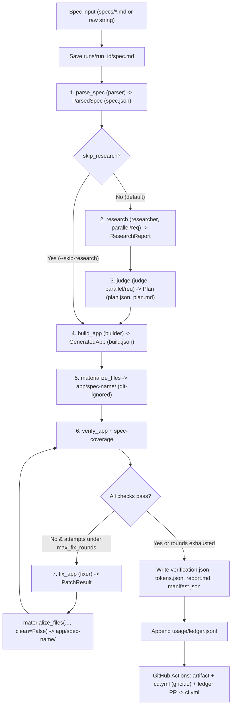

# Atlas Architecture

This document explains how Atlas orchestrates LLM calls, turns a written or typed specification into a verified product inside `app/<spec-name>/`, and how to extend roles such as `builder` and `fixer` with reusable skills.

---

## 1. Orchestration Model (Plain Async Python, Not LangChain/LangGraph)

Atlas **does not use LangChain or LangGraph**.

Per [ADR 0001: Plain Python pipeline in Phase 1](docs/decisions/0001-phase1-plain-python.md), orchestration is implemented directly with standard Python `asyncio`, strict `Pydantic` v2 models, and `LiteLLM`:

- **Orchestrator ([`src/atlas/runner.py`](src/atlas/runner.py)):** `run_plan` and `run_build` are plain `async` functions that call each pipeline stage in sequence, manage artifacts under `runs/<run-id>/`, and drive the build/verify/fix loop.
- **Typed State Contracts ([`src/atlas/schemas.py`](src/atlas/schemas.py)):** Every stage communicates via strict `Pydantic` (`StrictModel`, `extra="forbid"`) schemas — `ParsedSpec`, `ResearchReport`, `Plan`, `GeneratedApp`, `PatchResult`, and `VerificationReport`.
- **Unified LLM Client ([`src/atlas/router.py`](src/atlas/router.py)):** `ModelRouter` wraps `litellm.acompletion` across providers (currently OpenRouter primary with Gemini fallbacks in [`config/models.yaml`](config/models.yaml)), enforcing concurrency caps, output token limits, timeouts, budgets, key fallbacks, and token/cost logging.

**Why this choice:** Keeping orchestration in plain Python makes execution paths, failure modes, and exact token spend transparent with minimal dependencies. At the same time, each stage function and Pydantic schema is cleanly decoupled so it can map 1:1 to LangGraph nodes if multi-turn agent loops, persistent checkpoints, or human-in-the-loop pause/resume are added in a later phase (see [ROADMAP.md](ROADMAP.md)).

---

## 2. End-to-End Flow: Spec Input to `app/<spec-name>/`

### Markdown File vs. Typed / Interactive Spec Input

Today, the CLI commands `atlas plan <spec.md>` and `atlas build <spec.md>` ([`src/atlas/cli.py`](src/atlas/cli.py)) take a path to a Markdown file (for example [`specs/example-app.md`](specs/example-app.md)), read `raw_spec` from disk in `run_plan` / `run_build`, and immediately snapshot a copy to `runs/<run-id>/spec.md`.

Because every downstream stage works solely from that `raw_spec` string and `ParsedSpec`, supporting a spec typed directly in a CLI prompt, web UI, or API only requires saving that text to a temporary/run `.md` file (or passing the string directly into `parse_spec(router, raw_spec)`). No changes to the `research`, `judge`, `build`, or `verify` stages are needed.

### Stage-by-Stage Breakdown

| Stage | Module & Function | Role in `models.yaml` | Concurrency | Input | Validated Output | Artifacts Saved |
| :--- | :--- | :--- | :--- | :--- | :--- | :--- |
| **1. Parse** | [`parse_spec`](src/atlas/pipeline/parse.py) | `parser` | 1 call | Raw Markdown spec (`raw_spec`) | `ParsedSpec` (requirements DAG checked for cycles/unknown IDs) | `spec.md`, `spec.json` |
| **2. Research** *(optional)* | [`research`](src/atlas/pipeline/research.py) | `researcher` | Parallel across `(requirement x deduplicated available model)` | `ParsedSpec` context + single `Requirement` | `ResearchNote` list + `ResearchFailure` list inside `ResearchReport` | `research.json` |
| **3. Judge** *(optional)* | [`judge`](src/atlas/pipeline/judge.py) | `judge` | Parallel per requirement (`asyncio.gather`) | Project overview + target `Requirement` + its filtered research notes | 1 `ToolDecision` (2–3 options + pick) per requirement -> assembled `Plan` + SHA-256 hash | `plan.json`, `plan.md` |
| **4. Build** | [`build_app`](src/atlas/pipeline/build.py) | `builder` | 1 call | `ParsedSpec` + `Plan` (or `raw_spec` directly if `--skip-research`) | `GeneratedApp` (relative path safety + unique paths validated) | `build.json`, files written via `materialize_files` to `app/<spec-name>/` |
| **5. Verify** | [`verify_app`](src/atlas/pipeline/verify.py) + `check_requirement_coverage` | *(No LLM call)* | Subprocesses in stripped env | Files inside `app/<spec-name>/` + functional IDs | `CheckResult` list (compile, tests, lint/build, `spec-coverage`) | Recorded in `VerificationRound` |
| **6. Fix Loop** *(up to `max_fix_rounds`)* | [`fix_app`](src/atlas/pipeline/build.py) | `fixer` | 1 call per failed round | `ParsedSpec`, optional `Plan`, failing checks, current file snapshot of `app/<spec-name>/` | `PatchResult` (`diagnosis`, `files`, `delete_files`) -> incremental `materialize_files` | Re-runs Step 5 after each patch |
| **7. Reporting** | [`summarize_usage`](src/atlas/telemetry.py), [`render_run_report`](src/atlas/pipeline/render.py) | *(No LLM call)* | Always runs (`finally` block) | `router.call_log`, `VerificationReport` | `TokenUsageSummary`, Markdown report, run ledger line | `verification.json`, `tokens.json`, `report.md`, `manifest.json`, `usage/ledger.jsonl` |

#### Stack Verification Details (Step 5)

`verify_app` detects the stack (`python`, `node`, `mixed`, or `other`) and runs checks in an isolated environment (`_verification_env`) with sensitive environment variables (`*_API_KEY*`, `*_TOKEN*`, `*_SECRET*`, `DATABASE_URL`, `GITHUB_*`, etc.) stripped:

- **Python:** `python -m compileall -f -q .` (`python-compile`), `python -B -m pytest` (`python-pytest`), and `ruff check --isolated --no-cache .` (`python-ruff` if `ruff` is available). If external dependencies are declared or `pytest` is absent, Atlas provisions an isolated temporary virtualenv via `uv` or `python -m venv`.
- **Node.js:** `npm install --no-audit --no-fund` if dependencies exist without `node_modules`, followed by `npm test` (or `node --test` on `*.test.{js,mjs,cjs}`), plus optional `typecheck`, `build`, and `lint` scripts if defined in `package.json`.
- **Requirement traceability (`spec-coverage`):** When `verification.require_requirement_tests: true` in `config/models.yaml`, `check_requirement_coverage` verifies that every functional requirement ID (e.g. `R001`) appears in at least one test file (such as a test name or comment).

---

## 3. How Model Calls Work Under the Hood

### Structured JSON Enforcement (`complete_json_model`)

Every LLM stage routes through [`complete_json_model`](src/atlas/pipeline/util.py):

1. Loads the stage's Markdown system prompt via `prompt(name)` from `src/atlas/prompts/` (`parse.md`, `research.md`, `judge.md`, `build.md`, `fix.md`).
2. Sends `system` and `user` prompts through `router.complete(...)` requesting structured JSON output.
3. Extracts JSON even if wrapped in prose or fenced code blocks (`extract_json` / `extract_json_object`).
4. Runs an optional stage `postprocess` hook (for example, `attach_metadata` in [`src/atlas/pipeline/research.py`](src/atlas/pipeline/research.py)) and validates against the stage's Pydantic schema (`StrictModel`).
5. If JSON parsing or Pydantic validation fails, retries up to `router.repair_attempts` times, appending the validation error to the prompt so the model can self-correct.

### Routing, Limits, Fallbacks & Spend Protection (`ModelRouter`)

[`ModelRouter`](src/atlas/router.py) reads [`config/models.yaml`](config/models.yaml) and coordinates all model calls:

- **Concurrency Gate:** Bounds simultaneous in-flight LLM requests with an `asyncio.Semaphore` sized by `limits.max_parallel_calls` (`6` by default).
- **Per-Role Limits & Timeouts:** Applies `limits.max_tokens_by_role` (`researcher: 12000`, `judge: 16000`, `builder: 32000`, `fixer: 16000`, fallback `max_tokens: 6000`) and `limits.timeout_seconds_by_role` via `max_tokens_for(role)` and `timeout_for(role)`.
- **No Wasted Retries on Cut-Off Replies:** If a reply is truncated at the output token limit, Atlas raises `OutputTruncatedError` and stops immediately instead of burning tokens retrying the same prompt on fallback models with the same cap.
- **Pre-Send Budget Guard:** Checks `limits.max_total_tokens` and `limits.max_cost_usd` inside `_check_budget()` immediately before each call is sent (so parallel queued calls respect spend as earlier ones complete).
- **Provider Key Fallback & Skipping:** On HTTP 401/402, `_switch_to_fallback_key` checks `<PROVIDER>_API_KEY_FALLBACK` (for example `OPENROUTER_API_KEY_FALLBACK`) before `_mark_unavailable` skips that provider/model for the rest of the run and moves to `role_fallbacks`.
- **Complete Spend Accounting:** [`extract_usage_metrics`](src/atlas/telemetry.py) records every billed response—including empty or truncated replies—preferring direct provider cost (`usage.cost`, such as from OpenRouter) before falling back to `litellm.completion_cost`.

---

## 4. Built Products vs. Git & CI/CD

Generated apps are treated as build/deploy products rather than committed template code:

- **Per-Spec Output Directory:** By default, `default_app_dir(spec_path)` in [`src/atlas/pipeline/build.py`](src/atlas/pipeline/build.py) targets `app/<spec-name>/` (overrideable with `--app-dir`). With `--clean`, `materialize_files` preserves `.gitkeep`.
- **Git-Ignored Products:** [`.gitignore`](.gitignore) excludes `app/*` (keeping `!app/.gitkeep`) and `runs/*`, ensuring generated applications and run logs are never pushed to Git.
- **GitHub Actions Pipeline ([`.github/workflows/spec-to-app.yml`](.github/workflows/spec-to-app.yml)):**
  1. Triggers on pushed spec changes under `specs/` or manual `workflow_dispatch`.
  2. Runs `atlas build` into `app/<spec-name>/`.
  3. Uploads `atlas-product-<spec-name>` and `atlas-run-artifacts` as workflow artifacts.
  4. Calls reusable [`.github/workflows/cd.yml`](.github/workflows/cd.yml) when verification passes to build and publish a Docker image to `ghcr.io/<owner>/<repo>/<spec-name>`.
  5. Opens a PR updating `usage/ledger.jsonl` and the report, which triggers [`.github/workflows/ci.yml`](.github/workflows/ci.yml).

---

## 5. How to Add Skills (for `builder`, `fixer`, and Other Roles)

Currently, all stage instructions live in static Markdown files under `src/atlas/prompts/` (`parse.md`, `research.md`, `judge.md`, `build.md`, `fix.md`); Atlas does not yet load an external `skills/` directory. Because every stage already passes explicit `system` and `user` strings through `complete_json_model`, you can add skills cleanly in three stages of complexity:

### Option A: Markdown Prompt Skills (Recommended Today)

Store reusable domain playbooks in a workspace `skills/` folder (e.g., `skills/python-fastapi/SKILL.md`, `skills/nextjs-app/SKILL.md`, `skills/dockerfile-prod/SKILL.md`) containing architecture conventions, preferred test patterns (such as tagging functional requirement IDs like `# R001` for `spec-coverage`), and `Dockerfile` guidelines.

To wire them into `builder` and `fixer`:

1. **Load skill Markdown files:** Add a helper (for example `load_skills(skill_names, skills_dir=Path("skills"))`) that reads each `skills/<name>/SKILL.md`.
2. **Choose where skills are declared:**
   - **Per role in `config/models.yaml`:** e.g. `skills: { builder: ["dockerfile-prod"], fixer: ["pytest-debugging"] }`.
   - **Inside the spec / CLI:** parse an optional `skills: list[str]` field on `ParsedSpec` in [`src/atlas/schemas.py`](src/atlas/schemas.py), or add `--skill` in [`src/atlas/cli.py`](src/atlas/cli.py) and pass `skills` into `run_build` ([`src/atlas/runner.py`](src/atlas/runner.py)).
3. **Inject into the role prompt:** In `build_app(...)` and `fix_app(...)` inside [`src/atlas/pipeline/build.py`](src/atlas/pipeline/build.py), append the loaded skill blocks to `system = prompt("build")` / `prompt("fix")` before calling `complete_json_model(...)`.

### Option B: Stack-Aware / Progressive Skill Injection (Save Prompt Tokens)

To avoid bloating every build prompt with unrelated instructions:

- Let `parse_spec` or a lightweight rule inspect `ParsedSpec.constraints` and `Plan.decisions` (`decision.pick`), then load only matching skills (for example, inject `skills/react-vite/SKILL.md` only when Judge selects React/Vite).
- Or expose only skill names and one-line descriptions to `judge`, then inject full `SKILL.md` bodies only into `builder` and `fixer`.

### Option C: Executable Tool-Calling Skills (Future Multi-Turn Upgrade)

Today `builder` and `fixer` return a full `GeneratedApp` or `PatchResult` JSON payload in one response. If future skills need models to run commands, inspect docs dynamically, or read/edit large repositories incrementally:

- Extend `ModelRouter.complete` ([`src/atlas/router.py`](src/atlas/router.py)) to accept `tools=[...]` and run an async tool-call loop around `litellm.acompletion`, or
- Promote `build_app` and `fix_app` into stateful graph nodes (e.g. LangGraph) while keeping the existing `ParsedSpec`, `Plan`, `GeneratedApp`, `PatchResult`, and `VerificationReport` Pydantic contracts intact.

---

## 6. Module Reference

| Path | Responsibility |
| :--- | :--- |
| [`src/atlas/cli.py`](src/atlas/cli.py) | CLI entrypoint (`plan`, `build`, `verify`, `tokens`, `changed-specs`, `app-dir`, `validate-config`) |
| [`src/atlas/runner.py`](src/atlas/runner.py) | Plain async pipeline orchestration (`run_plan`, `run_build`, `record_approval`) and artifact/ledger writing |
| [`src/atlas/router.py`](src/atlas/router.py) | `ModelRouter`: LiteLLM wrapper, role/fallback routing, budgets, key fallback, timeouts, token caps, `call_log` |
| [`src/atlas/schemas.py`](src/atlas/schemas.py) | Strict Pydantic v2 contracts across all stages and path-safety validation |
| [`src/atlas/pipeline/parse.py`](src/atlas/pipeline/parse.py) | `parse_spec` (`parser` -> `ParsedSpec`) |
| [`src/atlas/pipeline/research.py`](src/atlas/pipeline/research.py) | Parallel per-requirement research (`researcher` -> `ResearchReport`) |
| [`src/atlas/pipeline/judge.py`](src/atlas/pipeline/judge.py) | Parallel per-requirement option selection (`judge` -> `Plan`) |
| [`src/atlas/pipeline/build.py`](src/atlas/pipeline/build.py) | `build_app` (`builder`), `fix_app` (`fixer`), `default_app_dir`, `materialize_files`, `snapshot_app_files` |
| [`src/atlas/pipeline/verify.py`](src/atlas/pipeline/verify.py) | Stack detection, isolated Python/Node verification checks, `spec-coverage`, env scrubbing |
| [`src/atlas/pipeline/util.py`](src/atlas/pipeline/util.py) | Prompt loader (`src/atlas/prompts/*.md`), JSON extraction, `complete_json_model` validation/repair loop |
| [`src/atlas/pipeline/render.py`](src/atlas/pipeline/render.py) | Markdown rendering for `plan.md` and `report.md` |
| [`src/atlas/telemetry.py`](src/atlas/telemetry.py) | Token/cost extraction, usage summaries (`tokens.json`), and JSONL ledger (`usage/ledger.jsonl`) |
| [`config/models.yaml`](config/models.yaml) | Model roles, fallbacks, concurrency, token caps, timeouts, cost/token budgets, coverage toggle |
| [`docs/decisions/0001-phase1-plain-python.md`](docs/decisions/0001-phase1-plain-python.md) | Architectural decision record explaining plain Python over LangGraph in Phase 1 |
| [`.github/workflows/`](.github/workflows/spec-to-app.yml) | CI (`ci.yml`), spec-to-app build & PR reporting (`spec-to-app.yml`), and Docker/GHCR publishing (`cd.yml`) |
