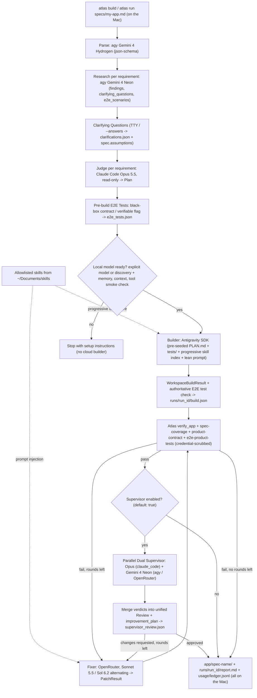

# Atlas Agentic Harness & Local-First Builder Plan

> **Status:** Implemented (Phases 1–5 + Dual Post-Build Supervisor in [`config/harness.yaml`](../config/harness.yaml), 2026-11-24; **Updated 2026-11-25:** live preflight `atlas doctor` & `atlas detect-local` verified on the M5 24 GB Mac across `agy` 1.5.15 cached login, `claude` 2.1.325 subscription, `google-antigravity` 0.1.24, and LM Studio `google/gemma-4-26b-a4b-qat`; added real-time `[HH:MM:SS]` `stderr` stage/`k/N` progress logging + `-q`/`--quiet`, dedicated `e2e` role/limits, `--disable-slash-commands` single-turn constraint, and deduplicated `AGY_ERROR` reporting). Offline test suite passes (`242 passed, 1 skipped`). **Contract-checked without paid calls (2026-11-24):** the Claude adapter against the real `claude` 2.1.331 binary talking to a local mock of the Anthropic API, the SDK adapter against the installed `google-antigravity` 0.1.24 API surface, and the `agy` adapter against the documented headless JSON envelope (section 14).
> **Related:** [ARCHITECTURE.md](../ARCHITECTURE.md) | [ADR 0001](decisions/0001-phase1-plain-python.md)

---

## 0. Decisions at a glance

| Topic | Decision | Status |
| :--- | :--- | :--- |
| Builder | **Local model only**, via Ollama or LM Studio, running inside the Antigravity Python SDK harness. No cloud builder: if no local model is ready, Atlas stops with setup instructions. | Confirmed |
| Parser & researcher | Antigravity CLI `agy` (Gemini 4 Hydrogen / Gemini 4 Neon), structured JSON. If `agy` fails the Phase 0 spike, these stay on today's `ModelRouter`. | Confirmed, spike-gated |
| Judge | Claude Code `claude`, Opus 5.5, **strictly read-only** (pre-build planning). | Implemented |
| Post-build Supervisor | **Dual parallel panel:** Claude Opus (`claude_code`, read-only) + Gemini 4 Neon (`agy` with OpenRouter fallback), merging findings into one unified review + improvement plan sent to Fixer. | Implemented |
| Fixer | **OpenRouter through `ModelRouter`**, alternating Claude Sonnet 5.5 and OpenAI Sol 6.2 between rounds. **No Codex.** | Confirmed |
| Verifier | Atlas `verify_app` + `spec-coverage`, credential-scrubbed, no model. Unchanged. | Confirmed |
| Framework vs products | **Atlas is the framework; each product in `app/<spec-name>/` stands on its own.** Products are built and tested on your Mac, with **their own tests** that `verify_app` runs. GitHub CI, when you add it, tests only the Atlas framework. Deploying a product is a separate, later step (section 9). | Confirmed |
| Interactive `atlas` chat | Deferred. `atlas run <spec.md>` alias kept as a small step. | Deferred |
| Your setup | M5 MacBook, 24 GB unified memory; ChatGPT Free; Ollama installed (has a `gemma4` model); LM Studio not installed; GitHub CI not used. | Recorded |
| Claude plan | Claude Code needs Pro or higher (or an API key). | **Open question** |

---

## 1. Overview & design goals

Today every pipeline role is one API request through `ModelRouter` (LiteLLM), so the builder has to return the whole codebase in a single JSON reply (`GeneratedApp`). This plan turns Atlas into a **hybrid harness orchestrator**:

1. **Local-first builder:** a local model edits files directly in an isolated workspace, through the Antigravity SDK (`LocalOpenAIAgentConfig(...).lightweight()`), with Ollama (`localhost:11434`) or LM Studio (`localhost:1234`) serving the model.
2. **Structured stages in harnesses:** parse and research through `agy`; judge through read-only Claude Code. They still return validated Pydantic objects.
3. **Independent, sequential fixing:** OpenRouter fixes failed checks, a different model each round, never at the same time as another stage.
4. **Atlas stays the gatekeeper:** `verify_app` + `spec-coverage` decide pass or fail. No harness can mark its own work as done.
5. **Honest accounting:** every call is recorded with where its cost came from (reported, estimated, subscription, local, unavailable). Unknown cost is never shown as $0.
6. **Skills:** allowlisted skills from `~/Documents/skills` reach the roles that need them, nothing else.
7. **Spike first:** a disposable Phase 0 proves each harness works as a subprocess before any core module is refactored.
8. **Self-contained products:** every product carries its own tests, dependency file, README and (for runnable apps) Dockerfile, so it can be tested on its own now and moved to its own repository and deployed later.

---

## 2. Role-to-harness mapping

| Role | Harness / backend | Model(s) | Contract & safeguards |
| :--- | :--- | :--- | :--- |
| **Parser** | Antigravity CLI `agy` | `gemini-4-hydrogen-high` | `agy -p … --output-format json --json-schema <ParsedSpec>`; validated by Pydantic. |
| **Researcher** | Antigravity CLI `agy` | `gemini-4-neon-high` | Per requirement, `--json-schema <ResearchNote>` + `--disable-slash-commands`; emits `Evidence`, `clarifying_questions` (interactive/prefilled before Judge & Build), and `e2e_scenarios`. Parallel harness processes limited to 2–3 (`420s` timeout, `24K` fallback cap). |
| **Judge** | Claude Code `claude` (read-only) | Claude Opus 5.5 | Per requirement: `ResearchReport` → decision; `--json-schema`, no tools, `--max-budget-usd`. Interim option before `claude` is on `PATH`: `agy` with `claude-opus-5-5-high`. |
| **E2E (`e2e`)** | Antigravity CLI `agy` (fallback OpenRouter) | `gemini-4-neon-high` | Pre-build `generate_e2e_tests` (`--e2e-tests` / `require_e2e_tests: true`); compact prompt (omits raw findings & rejected candidates when `Plan` exists), single-turn `--disable-slash-commands`, `600s` timeout / `32K` fallback cap; locks down black-box `tests/` files (`e2e-product-tests`). |
| **Supervisor** *(post-build dual panel)* | Parallel `reviewers`: Claude Code (`claude`, read-only) + Antigravity CLI `agy` (fallback OpenRouter) | Claude Opus 5.5 + Gemini 4 Neon | After green checks, both inspect the built app against the spec independently (`unanimous` mode by default). Verdicts merge into one unified `Review` (`issues` + `improvement_plan` in `supervisor_review.json`); any flagged issues go sequentially to the Fixer. |
| **Builder** | Antigravity Python SDK `LocalOpenAIAgentConfig(model, base_url).lightweight()` | Auto-discovered local Gemma 4 (`google/gemma-4-26b-a4b-qat` / `gemma-4-26b-a4b-it-qat-mlx-4bit` on LM Studio, else `gemma4:12b-mlx` / `gemma4:12b` on Ollama) passing section 5 checks | Edits files in an isolated workspace → `WorkspaceBuildResult` (diff + snapshot). **Local only; fails clearly if no model is ready.** |
| **Fixer** | OpenRouter via `ModelRouter` | Round 1, 3, …: Claude Sonnet 5.5. Round 2, 4, …: OpenAI Sol 6.2 | Runs only when verification fails; returns `PatchResult` (full replacement files), applied through `materialize_files` path checks. Each round gets the previous round's diagnosis and the `writing-clean-code` skill. |
| **Verifier** | Atlas built-in `verify_app` | none | Runs the **product's own tests** (pytest / `npm test`) plus compile, lint and build checks, `spec-coverage` and the product contract (section 4.1); credential-scrubbed (`_verification_env`). |

### Verified local laptop audit (checked on the Mac, 2026-11-23)

- **Hardware:** M5 MacBook, **24 GB unified memory**.
- **Antigravity `agy`:** installed at `/opt/homebrew/bin/agy`. `agy models` lists `gemini-4-hydrogen-{low,medium,high,xhigh}`, `gemini-4-neon-{low,medium,high,xhigh}`, `claude-opus-5-5-{low,medium,high}`, `claude-sonnet-5-5-{low,medium,high}`.
- **Ollama:** installed at `/opt/homebrew/bin/ollama`; a `gemma4` model is downloaded; daemon was stopped (`ollama serve` needed).
- **LM Studio:** not installed (`lms` not on `PATH`, no `~/.lmstudio`). Discovery still probes `http://localhost:1234/v1/models` if you start it later.
- **Claude Code:** `Claude.app` installed with an embedded binary (`~/Library/Application Support/Claude/claude-code-vm/2.1.330/claude`); standalone `claude` not on `PATH` yet → `npm install -g @anthropic-ai/claude-code`.
- **Codex:** not installed and **not needed** (fixer is OpenRouter). `ChatGPT.app` and `~/.codex/auth.json` exist, but ChatGPT Free only includes limited trial access to Codex.
- **`.env`:** `ANTHROPIC_API_KEY` is empty, so Claude Code will use your subscription login (see section 8).

---

## 3. End-to-end flow



---

## 4. Workspace contract split (`GeneratedApp` vs `WorkspaceBuildResult`)

Today `build_app` ([`src/atlas/pipeline/build.py`](../src/atlas/pipeline/build.py)) calls `complete_json_model`, expects the whole app in one `GeneratedApp` JSON, then runs `materialize_files()`. A harness edits files on disk instead, so contracts split by stage type:

- **Structured stages** (parse, research, judge, supervisor): keep returning validated Pydantic objects (`ParsedSpec`, `ResearchNote`/`ResearchReport`, `Plan`, a new `Review`).
- **Workspace stage** (builder):
  1. Prepare an isolated workspace for `app/<spec-name>/` and record a baseline.
  2. Pre-seed `PLAN.md`, authoritative `tests/` E2E test files, and allowlisted `.agents/skills/` symlinks **before** launching the local Builder so the local model reads them from disk and can test against the E2E suite as it builds.
  3. Pass a lean local prompt (`max_prompt_chars`, compact spec requirements, `PLAN.md` / `tests/` paths, and progressive skill index via `format_role_skill_index` when `discovery_mode: progressive`) to protect smaller local context windows.
  4. After the harness exits, re-materialize authoritative E2E test files (`verifiable: true` only; explicit `unverifiable_reason` otherwise), capture `WorkspaceBuildResult`, reject escaping paths or git changes outside `app/<spec-name>/`, and save `runs/<run-id>/build.json`.
  5. Run `verify_app` + `spec-coverage` + `product-contract` + `e2e-product-tests` -> sequential OpenRouter `fix_app` (`PatchResult`) -> Dual Post-Build Supervisor (`opus` + `neon`).
- **Dependency installs stay in Atlas:** `verify_app` already installs dependencies (temporary venv / `npm install`), so the builder does not need network access.
- `GeneratedApp` stays for any `ModelRouter`-based build (tests, future cloud mode).

### 4.1 Product contract (every `app/<spec-name>/`)

A product is not part of Atlas. It must be able to live on its own:

- **Own tests inside the product** (`tests/` with pytest, or `npm test`), runnable from the product folder alone: `cd app/<spec-name> && pytest` (or `npm test`). These are the product's tests, not Atlas's.
- **Every functional requirement ID** (`R001`, `R002`, …) appears in at least one of those tests (`spec-coverage`).
- **Tests run offline**, with no paid services or secrets (already required by `specs/TEMPLATE.md`; `verify_app` runs them credential-scrubbed).
- **Own dependency file** (`pyproject.toml` / `requirements.txt` / `package.json`), a **README** with install, test and run commands, and a **Dockerfile** for runnable CLIs and services (already asked for in the build prompt).
- **No imports from Atlas and no paths outside the product folder**, so the product can later move to its own repository with its own CI and deployment.
- **Checked by a new `product-contract` check** in `verify_app` (Phase 4): README and dependency file present, tests runnable from the product folder, no `import atlas`. A failure goes to the fixer like any other check.
- **Optional later:** `git init` inside the product folder so it becomes its own repository (the framework repo already ignores `app/*`).

---

## 5. Local-first builder

### 5.1 Antigravity SDK interface (checked against the published docs)

```python
from google.antigravity import Agent, LocalOpenAIAgentConfig

config = LocalOpenAIAgentConfig(
    model="gemma4:12b-mlx",                  # or LM Studio's gemma-4-26B-A4B-it-QAT-MLX-4bit
    base_url="http://localhost:11434/v1",     # LM Studio: http://localhost:1234/v1
).lightweight()                               # trims system prompt and subagents for local hardware
```

- The SDK is pre-1.0 (alpha). Pin the exact `google-antigravity` version in `pyproject.toml` **only after Phase 0 succeeds**.
- **Checked against the installed 0.1.24 package** (`test_installed_antigravity_sdk_matches_what_the_adapter_calls`, runs whenever the SDK is installed): `hooks.policy.workspace_only(workspaces)` and `auto()`, the `model` / `base_url` / `workspaces` / `policies` / `skills_paths` config fields, `.lightweight()` (keeps `run_command`, `view_file`, `create_file`, `edit_file`), `async with Agent(cfg)`, `await response.text()` and `response.usage_metadata` (prompt / candidates / cached / thoughts / total token counts for the whole turn).
- **The SDK starts its local harness with a copy of Atlas's environment**, and its `env` option can only add variables. The adapter therefore hides every credential from `os.environ` while the agent session runs (section 8.2).
- Phase 0 must confirm: workspace scoping (the agent can only write inside its workspace; the SDK's policy hooks can deny everything else), whether token usage is reported for local models, and whether skills are discovered.

### 5.2 Picking the local model (readiness checks, not "largest model")

1. **Explicit model first:** `backends.builder.local_model` (set to `null` in [`config/harness.yaml`](../config/harness.yaml) for auto-discovery across LM Studio and Ollama).
2. **Discovery fallback** when `local_model` is `null` (each probe has a short timeout, about 1.5 s, so a stopped server does not slow Atlas down):
   - **Ollama:** `GET /api/tags` → `models[].name`, `details.parameter_size` (`12B`, `26B`, …), `size` (bytes), `details.family`; `POST /api/show` → `capabilities` and context length; `GET /api/ps` → what is loaded and with which context.
   - **LM Studio:** `GET /v1/models` → model IDs; read parameter counts from metadata or the name (regex `(\d+(?:\.\d+)?)\s*[bB]`, `M` = 0.001 B).
3. **Filter out:**
   - embeddings and rerankers (`embed`, `bge`, `nomic-embed`, `mxbai-embed`, `rerank`);
   - models without tool calling (Ollama `capabilities` must include `tools`);
   - models below `min_context_tokens` (32,768). Ollama defaults to a 4,096-token context so start it with `OLLAMA_CONTEXT_LENGTH=64000`, and load LM Studio at 32K–64K;
   - models whose estimated footprint exceeds `memory_budget_fraction` of RAM (`0.78`, about 18.7 GB on a 24 GB Mac).
4. **Rank** what is left: the `preferred` list first (`google/gemma-4-26b-a4b-qat`, `gemma-4-26b-a4b-it-qat-mlx-4bit`, `gemma4:12b-mlx`, `gemma4:12b`), then loaded status, parameter count, and file size.
5. **Tool smoke check:** before the build, the chosen model must make a valid `ping` tool call (`tool_choice="required"`, `max_tokens=256`, `timeout=180s` so swap-in after long planning stages succeeds). `probe_lm_studio` also reads `/api/v0/models` to capture `loaded` state, runtime `loaded_context_length`, and `tool_use` capabilities.
6. **Runtime context check (Ollama):** `/api/show` reports the model's *trained* maximum (often 128K), not what Ollama serves. The smoke call loads the model, so Atlas then reads `/api/ps` and rejects the model if it was loaded below `min_context_tokens`, telling you to restart with `OLLAMA_CONTEXT_LENGTH=…`. Without this, a 4,096-token default would silently truncate the builder's prompt.
7. **No model ready → stop** with clear instructions (`ollama serve`, `ollama pull gemma4:12b-mlx`, start LM Studio's server). There is no cloud builder fallback.

### 5.3 Model choice for this Mac (M5, 24 GB)

| Model | Size | Fit on 24 GB | Role here |
| :--- | :--- | :--- | :--- |
| `google/gemma-4-26b-a4b-qat` / `gemma-4-26b-a4b-it-qat-mlx-4bit` (LM Studio) | 15.6 GB (MoE, 4B active) | Fits with 32K–64K context (~17.3 GB est. < 18.7 GB cap) | **1st `preferred` choice.** Fast MLX MoE when LM Studio's local server is running. |
| `gemma4:12b-mlx` / `gemma4:12b` (Ollama) | ~7.0 GB | Effortless fit with 64K context and ~16 GB free RAM | **Fallback `preferred` choice.** Selected automatically when LM Studio is stopped and Ollama is running. |
| `qwen3-coder:30b` | 19 GB at Q4 | Too big once context is added (suits 32 GB Macs) | Skip |
| Dense ~27B models | ~17 GB | Fits, but slow as an agent | Better for chat than for a build loop |

- **Ollama:** start it with `OLLAMA_CONTEXT_LENGTH=64000 ollama serve`.
- **LM Studio:** set the context length to 32K–64K (with KV-cache quantization recommended for 64K) when loading `gemma-4-26B-A4B-it-QAT-MLX-4bit`, then start its local server.
- **Expect more fix rounds:** for agents, reliable tool calls matter more than benchmark scores, so local builds will usually need more fix rounds than a cloud build. The ledger records `local_model`, `builder_backend` and `fix_rounds` per run, so after a few specs `atlas tokens --all` shows whether local building plus OpenRouter fixes still costs less.

---

## 6. Structured stages through harnesses

### 6.1 Antigravity CLI (`agy`): parser, researcher, and E2E tests

- **Call:** `agy -p "<prompt>" --model <id> --sandbox --disable-slash-commands --output-format json --json-schema <schema> --print-timeout <Ns>`.
- **Single-turn / read-only guard:** Structured calls with `cwd is None` (`parser`, `researcher`, `e2e`) prepend a strict single-turn no-tool constraint so `agy` answers with the JSON object directly instead of starting multi-turn tool loops inside an empty temp dir and hitting `--print-timeout`. Supervisor review (`cwd` set) switches to a strictly read-only inspection constraint.
- **Read the JSON envelope & deduplicated errors:** `status`, `response`, `structured_output`, `error`, `duration_seconds`, `num_turns`, `usage` (input, output, thinking, cache-read, total tokens). Non-zero exits parse `AGY_ERROR:` JSON (`short_error` + `status`) and deduplicate repeated timeout lines before surfacing `HarnessError`. It reports **no cost and no model field**, so record the requested model.
- **Check `status == "SUCCESS"`, not only the exit code:** `agy` exits `0` even when permission requests were soft-denied.
- **Always pass `--print-timeout`:** without it a run has no time limit.
- **Known risk:** `agy -p` has had a bug where it prints nothing when stdout is not a terminal, which is exactly how Atlas calls it. Phase 0 tests this. If it fails: run `agy` under a pseudo-terminal, or keep parse and research on `ModelRouter` (works today). Gemini CLI also has a documented headless JSON mode, if it is available on your account.

### 6.2 Claude Code (`claude`) & Dual Post-Build Supervisor (Opus + Gemini 4 Neon)

- **Judge (`claude`):** `claude -p "<prompt>" --model opus --output-format json --json-schema <schema> --tools "" --max-budget-usd 1.50`.
- **Dual Post-Build Supervisor (`supervise_app`):** runs `backends.supervisor.reviewers` in parallel (`asyncio.gather`) after deterministic checks pass:
  - **`opus` reviewer:** `claude -p "<prompt>" --model opus --output-format json --json-schema <SupervisorOutput> --tools Read,Grep,Glob --max-budget-usd 1.50` with working directory `app/<spec-name>/` (inspects files read-only; no write/shell tools).
  - **`neon` reviewer:** `agy -p "<prompt>" --model gemini-4-neon-high --output-format json --json-schema <SupervisorOutput> --sandbox --print-timeout 300s` (with `fallback: router` to `openrouter/google/gemini-4-neon`), receiving the spec, checks, and `current_files` snapshot.
  - **Unified merge (`merge_supervisor_reviews`):** combines both `ReviewerVerdict` records into one `Review` saved to `runs/<run-id>/supervisor_review.json` (with `unanimous` approval required by default), deduplicating tagged `issues` and building a single ordered `improvement_plan` (`src/atlas/prompts/supervisor.md`) that feeds straight into `fix_app` if either reviewer requests changes.
- **Never use `--dangerously-skip-permissions`.** No write or shell tools.
- **Reads `structured_output`** (schema-checked) plus `total_cost_usd`, `usage` and `modelUsage` (per model, includes subagents).
- **Pass tool rules on the command line:** Claude Code ignores a project's `.claude/settings.json` allow rules until the workspace trust prompt is accepted, so never rely on that file.
- Use `--max-budget-usd` as the spending cap; `--max-turns` is not listed in Claude Code 2.1.330's `--help`.

---

## 7. Fixer: OpenRouter, alternating models

- `ModelRouter` (OpenRouter) keeps the fixer. Round 1, 3, …: `openrouter/anthropic/claude-sonnet-5.5`; round 2, 4, …: `openrouter/openai/gpt-6.2-sol`.
- **Sequential only:** the fixer never runs while the builder, judge or supervisor is running.
- **Input:** the spec's requirements, failing checks (stdout/stderr tails), a snapshot of current files, the previous round's diagnosis, and the `writing-clean-code` skill text.
- **Output:** `PatchResult` (full replacement files or deletions), applied through `materialize_files` with the existing path checks.
- **Unchanged router safeguards:** per-role output limit and timeout, budget check before each call, stop at the first cut-off reply, skip a provider after HTTP 401/402.
- **Codex: not planned.** It would need extra install, auth and adapter work, and ChatGPT Free only includes limited trial access. Revisit only on a paid ChatGPT plan, checked by `atlas doctor`.

---

## 8. Permissions, authentication & credential isolation

### 8.1 Narrow permissions

- No `--dangerously-skip-permissions` anywhere.
- Judge and supervisor are read-only (above).
- The builder runs in an isolated workspace with SDK policies denying everything except file edits and safe local commands inside it; `agy` stages run with `--sandbox`.
- Fixer patches only touch files through `_validate_relative_app_path` / `materialize_files`.

### 8.2 Credential isolation per child process

- Each harness gets **only its own credentials**: `ANTHROPIC_*` / `CLAUDE_CODE_*` only to `claude`, `GEMINI_*` / `GOOGLE_*` / `ANTIGRAVITY_*` only to `agy`, nothing to the local builder.
- **Claude billing guard:** if `ANTHROPIC_API_KEY` is set, Claude Code uses it instead of your subscription and bills the API. Atlas loads `.env` into its own environment (and so does LiteLLM when it is imported), so the Claude adapter removes `ANTHROPIC_API_KEY` from `claude`'s environment unless `backends.judge.auth: api` is set on purpose. `atlas doctor` also flags a login whose `claude auth status` reports `authMethod: api_key`.
- **`agy` billing guard:** the same rule for `GEMINI_API_KEY` / `GOOGLE_API_KEY` / `ANTIGRAVITY_API_KEY`: they reach `agy` only with `auth: api` on that backend; otherwise `agy` uses its cached login and the ledger says `cached_login`.
- **Local builder:** the Antigravity SDK hands its harness a copy of `os.environ`, and the local model's `run_command` tool runs there. The adapter removes every credential (same rules as `verify_app`) from the process environment for the length of the session and restores it afterwards.
- `verify_app` keeps stripping every `*_API_KEY*`, `*_TOKEN*`, `*_SECRET*` and `GITHUB_*` variable.

### 8.3 `atlas doctor` (before any tokens are spent)

- **Checks for real** that each binary is on `PATH` (and records its version), the SDK imports, auth status, and that the Ollama / LM Studio servers answer. A credential file on disk (`~/.codex/auth.json`, Keychain entries) is not proof that a tool is ready.
- **Reports which auth mode each harness will use:**
  - **Claude Code:** subscription login, `CLAUDE_CODE_OAUTH_TOKEN`, or `ANTHROPIC_API_KEY`. Shown in the output and stored in the ledger, so subscription and API billing are never mixed up.
  - **`agy`:** cached login.
  - **OpenRouter:** API key.
- **In a terminal**, if a harness is not logged in, Atlas prints the exact login command (`agy` interactive sign-in, `claude auth login`), waits, and resumes. Without a terminal it fails fast.
- **`atlas doctor --live`** spends a few tokens per harness on a 1-line smoke call (opt-in).

| Harness | How it logs in locally | Headless note |
| :--- | :--- | :--- |
| `agy` | Cached login from one interactive `agy` session | Official docs only describe cached credentials; an unauthenticated run exits with `authentication required`. Not needed: harness stages only run on your Mac. |
| `claude` | `claude auth login` (Pro / Max / Ultra subscription) | `CLAUDE_CODE_OAUTH_TOKEN` (`claude setup-token`) or `ANTHROPIC_API_KEY`. |
| Ollama / LM Studio | none (localhost) | Builds only run on your Mac. |
| OpenRouter | `OPENROUTER_API_KEY` in `.env` | Same key everywhere. |

---

## 9. Framework vs products: where things are tested

### 9.1 Two kinds of tests

| | Atlas framework | A product (`app/<spec-name>/`) |
| :--- | :--- | :--- |
| Code | `src/atlas/`, `tests/`, `config/`, `docs/` | What the builder wrote for one spec |
| Tests | `tests/`: pytest, ruff, mypy. Offline, mocked models, never a real product | The product's own tests, run by `atlas verify` / `verify_app` |
| Where they run | Your Mac now; GitHub CI later (`ci.yml` `quality` job) | **Your Mac only** |
| In the framework's git repo | Yes | No: `app/*` is git-ignored |
| Deployment | None (it is a framework / template) | Later, separately (9.3) |

### 9.2 What this means for the existing workflows (no changes now)

- **Framework CI:** `ci.yml`'s `quality` job (ruff, mypy, pytest, pip-audit) is exactly the CI the framework needs. Keep it for when you start using GitHub.
- **Product jobs that do not fit:** `ci.yml`'s `verify-app` job, `spec-to-app.yml` (builds products in the cloud with OpenRouter) and `cd.yml` (publishes a product's Docker image from that cloud build). Products are never built or tested on GitHub.
- **Until then:** do not trigger `spec-to-app.yml`. When you set up framework CI, remove these product jobs from the framework repo, or move the deploy logic into a product's own repo (9.3).

### 9.3 Deploying a product (later)

This is a separate design for when you need it. Because every product is self-contained (4.1), the simplest path is to give the product its own git repository, with its own CI running its own tests and its own deployment. The existing `cd.yml` logic (Docker image to GHCR) can be reused there.

---

## 10. Honest usage & cost telemetry

Local and subscription runs do not always report dollars or even tokens. The ledger must never pretend they do.

**New `ModelCallRecord` fields** ([`src/atlas/schemas.py`](../src/atlas/schemas.py), [`src/atlas/telemetry.py`](../src/atlas/telemetry.py)):
- `harness`: `agy`, `claude_code`, `antigravity_sdk`, `openrouter`.
- `harness_version`, `elapsed_ms`.
- `auth_mode`: `subscription`, `oauth_token`, `api_key`, `cached_login`, `local`.
- `cost_source`:
  - `reported`: the provider returned a real USD cost (e.g. OpenRouter `usage.cost`).
  - `estimated`: tokens known, cost from a pricing table (LiteLLM).
  - `subscription`: flat-rate plan; `cost_usd: null` (Claude Code's own estimate may be stored as a separate notional figure).
  - `local_free`: Ollama / LM Studio; `cost_usd: 0.0`, tagged as local compute.
  - `unavailable`: the harness reported no usage or cost; `cost_usd: null`.
- **Run-level fields:** `local_model`, `builder_backend`, `fix_rounds`.

| Harness | What it reports |
| :--- | :--- |
| `agy` | tokens (input, output, thinking, cache-read, total); no cost; no model field |
| Claude Code | per-model tokens in `modelUsage` (includes the background Haiku calls; top-level `usage` covers only the main loop) + `total_cost_usd` (notional on a subscription). `input_tokens` excludes cache traffic, so Atlas records prompt = input + cache read + cache write |
| Antigravity SDK (local) | `usage_metadata` per turn (field names confirmed in 0.1.24); whether a local OpenAI endpoint fills it is still a Phase 0 check, otherwise `unavailable` tokens; always `local_free` cost |
| OpenRouter (`ModelRouter`) | tokens + cost |

- **Failed calls that were billed still count.** A Claude run stopped by `--max-budget-usd`, or an `agy` run ending with `status: ERROR`, carries its reported usage on the error, and the ledger records those tokens.
- **Never turn `None` into `$0.00`.** `report.md` and `atlas tokens --all` badge any run that has `subscription` or `unavailable` stages, and show "est. cost" only for `reported` / `estimated` calls.
- **Caps:**
  - `max_cost_usd` only sees `reported` / `estimated` calls, so also use `max_total_tokens` per run (works for every harness with token counts);
  - a wall-clock timeout per call (`--print-timeout`, `timeout_seconds`);
  - `claude --max-budget-usd`.

---

## 11. Skills (`~/Documents/skills` + `.agents/skills/`)

Atlas uses your existing skills folder (`/Users/professorshabangu/Documents/skills`) without copying files, through an explicit allowlist.

| Skill | Status | Role scope | Why |
| :--- | :--- | :--- | :--- |
| `developing-fullstack-apps` (mcpmarket 1.1.0) | Allowlisted | builder | FastAPI backend + Next.js frontend patterns and verification gates. *Note:* it is opinionated, so consider enabling it only for specs that ask for FastAPI / Next.js, or it may push a simple CLI spec toward a web stack. |
| `writing-clean-code` (2.0, priority CRITICAL) | Allowlisted | builder, fixer | Single responsibility, shallow nesting, clear names, pre-completion checks. |
| `writing-ee-blogin-posts` (2.0) | Allowlisted, idle | opt-in (`--skill`) / future chat | Equal Experts BlogIn drafting; not used in app builds. |
| 12 `dbt` skills (`using-dbt-for-analytics-engineering`, `adding-dbt-unit-test`, …) | Excluded by default | opt-in via `--skill` | Only for dbt projects. |
| `structuring-project-folders` | Excluded by default | opt-in / replace later | Written for the `Lungisi-EE` / `local_brainstorm_agent` repo (`Postgres`, `Qdrant`, `agent-system/`); would force that layout. |

**Wiring:**
1. **Antigravity (`agy` and the SDK builder):** Antigravity discovers `.agents/skills/<name>/SKILL.md` with progressive disclosure: only `name` + `description` up front, the full `SKILL.md` and `references/` on demand. Atlas symlinks only the allowlisted skills into the workspace's `.agents/skills/`. Phase 0 checks that the SDK builder and `agy` find them from `app/<spec-name>/`.
2. **OpenRouter fixer:** `src/atlas/skills.py` reads `SKILL.md` (YAML frontmatter + body) for allowlisted skills only and appends them to the fixer's system prompt. The judge and supervisor need no skills.

---

## 12. Proposed `config/models.yaml` additions

Existing `roles`, `role_fallbacks`, `limits` and `verification` stay; `ModelRouter` keeps serving the fixer (and parse/research if `agy` fails the spike).

```yaml
backends:
  parser:
    type: harness
    provider: antigravity
    model: gemini-4-hydrogen-high
    timeout_seconds: 180              # passed as agy --print-timeout
    fallback: router                  # only if agy fails Phase 0 or is unavailable

  researcher:
    type: harness
    provider: antigravity
    model: gemini-4-neon-high
    timeout_seconds: 420
    max_parallel: 3                   # harness processes are heavy on a laptop
    fallback: router

  judge:
    type: harness
    provider: claude_code             # interim: antigravity + claude-opus-5-5-high
    model: opus
    read_only: true                   # --tools "" ; never --dangerously-skip-permissions
    auth: subscription                # subscription | oauth_token | api (api keeps ANTHROPIC_API_KEY)
    max_budget_usd: 1.50              # claude --max-budget-usd
    timeout_seconds: 300

  e2e:
    type: harness
    provider: antigravity
    model: gemini-4-neon-high
    timeout_seconds: 600
    fallback: router

  supervisor:
    enabled: true                     # dual read-only post-build review (Opus + Neon)
    mode: unanimous                   # unanimous | any_approve
    reviewers:
      - name: opus
        type: harness
        provider: claude_code
        model: opus
        tools: [Read, Grep, Glob]
        auth: subscription
        max_budget_usd: 1.50
        timeout_seconds: 300
      - name: neon
        type: harness
        provider: antigravity
        model: gemini-4-neon-high
        timeout_seconds: 300
        fallback: router
        router_model: openrouter/google/gemini-4-neon

  builder:
    type: local_harness               # local only: no cloud builder
    local_harness: antigravity_sdk    # LocalOpenAIAgentConfig(model=..., base_url=...).lightweight()
    local_providers:
      ollama: http://localhost:11434/v1
      lm_studio: http://localhost:1234/v1
    local_model: null                 # auto-discover LM Studio 26B or Ollama 12B (section 5.2)
    preferred: [google/gemma-4-26b-a4b-qat, gemma-4-26b-a4b-it-qat-mlx-4bit, gemma4:12b-mlx, gemma4:12b]
    require_tools: true
    min_context_tokens: 32768         # Ollama: OLLAMA_CONTEXT_LENGTH=64000; LM Studio: 32K-64K
    memory_budget_fraction: 0.78      # ~18.7 GB of 24 GB
    require_tool_smoke_check: true
    timeout_seconds: 1800
    sandbox: true

  fixer:
    type: openrouter                  # sequential PatchResult via ModelRouter
    rotate:                           # round 1, 3, ...: first; round 2, 4, ...: second
      - openrouter/anthropic/claude-sonnet-5.5
      - openrouter/openai/gpt-6.2-sol

limits:
  max_tokens_by_role:
    researcher: 24000                 # Gemini 4 Neon reasoning tokens count inside completion cap
    judge: 16000
    e2e: 32000
    builder: 32000
    fixer: 24000
  timeout_seconds_by_role:
    researcher: 240
    judge: 300
    e2e: 300
    builder: 1800
    fixer: 300

limits_extra:
  max_total_tokens_per_run: null      # set a number to cap every harness by tokens

skills:
  sources: [~/Documents/skills, .agents/skills]
  discovery_mode: progressive
  allowlist: [developing-fullstack-apps, writing-clean-code, writing-ee-blogin-posts]
  by_role:
    builder: [developing-fullstack-apps, writing-clean-code]
    fixer: [writing-clean-code]
```

---

## 13. Roadmap

### Phase 0: disposable harness spike *(first; needs your approval)*

- **Kept separate from the project:**
  - a **scratch virtualenv** (not the project `.venv`) with `google-antigravity` installed;
  - a **scratch workspace outside the repo**;
  - a **scratch copy of the config** with a small cap for the one OpenRouter call (`max_cost_usd: 0.25`, fixer output limit 8,000 tokens).
- **Steps:**
  1. `agy -p --output-format json --json-schema` from a Python subprocess (no terminal): does JSON arrive, what is in `usage`, does `--print-timeout` work?
  2. Read-only `claude -p --json-schema --tools ""` on one requirement: `structured_output`, `total_cost_usd`, and the auth mode `atlas doctor` would report.
  3. `ollama pull gpt-oss:20b`, `OLLAMA_CONTEXT_LENGTH=64000 ollama serve`, SDK `LocalOpenAIAgentConfig(...).lightweight()`: tool smoke check, then one tiny throwaway build in the scratch workspace. Check `ollama ps` (no swapping), that writes stay in the workspace, token reporting, and skills discovery. Repeat the memory check with `gemma4:26b`.
  4. `verify_app` on the result, then **one** capped OpenRouter fix call.
  5. Save every raw output as `tests/fixtures/harness/*.json` and record tool versions.
- **Exit criteria:**
  - each harness returns parseable output from a subprocess;
  - the local build stays inside its workspace;
  - the fix call stays under the cap.
- **Only then** pin `google-antigravity` in `pyproject.toml`.
- **Expected spend:** `agy` and Claude use your plans' quota; the local build is free; the OpenRouter call is at most $0.25.

### Phase 1: config schema & `atlas doctor`
`config/models.yaml`, `src/atlas/router.py`, `src/atlas/cli.py`: parse and validate `backends`, `skills`, `limits_extra` in `atlas validate-config`; implement `atlas doctor [--live]` with real checks, auth-mode reporting, and interactive login help.

### Phase 2: local model resolver
New `src/atlas/local_models.py` + `atlas detect-local`: explicit-model-first resolution, Ollama / LM Studio discovery, embedding exclusion, tools / context / memory checks, ranking, smoke check, readable rejection reasons.

### Phase 3: harness adapters, workspace contract & skills
- New `src/atlas/harnesses/` (`base.py` with `check_auth`, `run_structured`, `run_workspace_task`; `antigravity_cli.py`, `antigravity_sdk.py`, `claude_code.py`).
- `WorkspaceBuildResult` in `schemas.py`, with the path and git-status guards.
- Credential scoping and the Claude billing guard.
- `src/atlas/skills.py`.
- Usage mapping into `ModelCallRecord` built from the Phase 0 fixtures.

### Phase 4: pipeline integration & honest telemetry
- `runner.py` and `pipeline/{parse,research,judge,build}.py` dispatch through `backends`.
- Fixer rotation with the previous diagnosis; optional supervisor stage.
- Ledger fields from section 10; `report.md` badges.
- `product-contract` check in `verify_app` (section 4.1).

### Phase 5: `atlas run <spec.md>`
A short alias for `atlas build <spec.md>`.

### Deferred (until the core loop is proven)
- Interactive bare `atlas` chat (`src/atlas/chat.py`) and conversational spec drafting (with `writing-ee-blogin-posts` available there).
- Codex as fixer (needs a paid ChatGPT plan; extra install and auth work).
- Cloud builder fallback.
- Product deployment (9.3): e.g. each product in its own repo with its own CI and Docker publishing.
- Framework CI on GitHub: keep `ci.yml`'s `quality` job; remove the product jobs (`verify-app`, `spec-to-app.yml`, `cd.yml`) from the framework repo.

---

## 14. Offline tests (no paid calls)

These are **framework** tests in `tests/`: offline, mocked models, never a real product. Product tests live inside each `app/<spec-name>/` and are run by `verify_app`.

- `tests/test_local_models.py`: explicit model wins; mocked Ollama `/api/tags`, `/api/show`, `/api/ps` and LM Studio `/v1/models`; embedding exclusion; tools / context / memory filters; ranking; smoke-check gating; clear failure when nothing is ready.
- `tests/test_harness_adapter_boundaries.py`: fake executable subprocesses for `agy` and read-only Claude structured output; Antigravity API-key auth failure; workspace diff and usage capture; SDK workspace scoping, timeout and cwd restoration; tool smoke-check acceptance/rejection. These are offline adapter tests, not live-provider Phase 0 calls.
- `tests/test_harness_cli_contracts.py`: drives the `claude` and `agy` adapters through real subprocesses that replay the CLIs' real JSON envelopes: cache-inclusive token counts, every billed model summed, prompt on stdin (a 400 KB prompt works), scoped env and both billing guards, error classification from structured fields (not substrings), billed usage kept on failures, `claude auth status` JSON, unrunnable binaries, hung-process timeouts, oversized `agy` prompts handed to `fallback: router`; the SDK builder hiding credentials; `atlas doctor` over the shipped `config/harness.yaml`. Two opt-in checks: `ATLAS_CLAUDE_CONTRACT=1` runs the **real `claude` binary** against a local mock Anthropic API (read-only tool list, structured output, budget stop, 401), and the SDK API-surface check runs whenever `google-antigravity` is installed.
- `tests/test_workspace_builders.py`: `build_app_workspace` through the `agy` builder (real subprocess editing the workspace), the local SDK builder (no ready model, SDK crash logged as a free local call) and an unsupported backend.
- `tests/test_local_model_readiness.py`: the Ollama runtime-context check and every tool smoke-check outcome.
- `tests/test_cli.py`: every `atlas` command in-process (plan, run/build exit codes, verify, tokens, ledger, changed-specs, validate-config, doctor, detect-local, error exit codes).
- `tests/test_config_validation.py`: the shipped configs load, and every invalid value is rejected with a message naming the key.
- `tests/test_verify_install_paths.py`: isolated-venv installs (with and without `uv`), early stops, and the Node install/test/script paths.
- `tests/test_skills_edge_cases.py`, `tests/test_skip_research_e2e.py`: frontmatter/precedence/symlink edge cases; `--skip-research` with clarifications and E2E tests.
- `tests/test_progress_logging.py`: real-time `[HH:MM:SS]` stage and `k/N` requirement progress logs, harness target labels (`antigravity/...`), TTY `prefilled` vs `prefilled + interactive` clarifications, and real subprocess `stdout`/`stderr` isolation across default, `--quiet`, and `--verbose` CLI modes.
- `tests/conftest.py`: stops LiteLLM from loading the real `.env` into the test process and removes provider credentials before every test.
- `tests/test_harnesses.py`: config validation, subprocess credential scoping, Claude read-only flags and billing guard, workspace path/git guards, auth checks, telemetry cost sources, doctor aggregation, supervisor review merging, parallel reviewers, fixer handoff, and report rendering.
- `tests/test_pipeline_contracts.py`: JSON extraction/repair; Pydantic contracts for parsed requirements, dependency cycles, decisions, plans, generated-file patches and safe relative paths.
- `tests/test_pipeline_flow.py`: parse/research/judge/build orchestration, partial provider failures, parallel judge calls, plan approval, fixer rotation and supervisor-to-fixer flow.
- `tests/test_research_clarify_e2e.py`: researcher clarifications, answer application, E2E test suite schema/integrity, workspace pre-seeding, lean prompts, tamper restoration, subprocess E2E verification, fixer recovery and unverifiable reporting.
- `tests/test_build_and_verify.py`: generated-file materialization/deletion, credential-scrubbed app verification, Python/Node checks, product contract, product test execution, autofix rounds, CLI behavior, app-directory and gitignore rules.
- `tests/test_router.py`: model/config validation, provider resolution, environment overrides, fallback behavior, telemetry, cost budgets and failure handling.
- `tests/test_tokens_and_coverage.py`: per-role and total token caps, truncation/empty replies, parallel spend limits, requirement-ID coverage and fixer recovery, credit/rate-limit handling, and judge call accounting.
- `tests/test_telemetry.py`: provider usage/cost extraction, cached/missing values, summaries, ledger totals and token-budget enforcement.
- `tests/test_render.py`: report tables and verified, failed and error status rendering.
- `tests/test_skills.py`: only the 3 allowlisted skills load (12 dbt skills and `structuring-project-folders` excluded); role scoping; `.agents/skills/` symlinks.
- `tests/test_workflows.py`: workflow YAML/shell syntax and static workflow guards/structure. These are Atlas framework workflow tests; they do not run generated product builds on GitHub.
- Later: `tests/test_chat_cli.py` with the chat feature.

**Current run (2026-11-25):** 242 passed, 1 skipped (offline suite); `ruff check` and `mypy src` are clean. Live `atlas doctor` and `atlas detect-local` verified on the M5 MacBook (`agy` 1.5.15 cached login, `claude` 2.1.325 subscription, `google-antigravity` 0.1.24, LM Studio `google/gemma-4-26b-a4b-qat`). Full live end-to-end build through local Gemma 4 + Dual Supervisor remains to be run.

---

## 15. Open questions

1. **Which Claude plan are you on?** Claude Code (judge, supervisor) needs Pro or higher, or an API key; the Free plan does not include it. If you are on Free, the judge uses `agy` with `claude-opus-5-5-high`, or OpenRouter.
2. **Approve Phase 0?** It installs the SDK in a scratch environment and makes a few live calls (plan quota + at most $0.25 on OpenRouter).

---

## Sources

- Antigravity SDK, local models: https://antigravity.google/docs/sdk/local-models/
- Antigravity CLI headless mode: https://antigravity.google/docs/cli/headless
- agy non-TTY output issue: https://github.com/google-antigravity/antigravity-cli/issues/76
- Antigravity skills: https://antigravity.google/docs/skills
- Gemini CLI headless mode: https://github.com/google-gemini/gemini-cli/blob/main/docs/cli/headless.md
- Ollama context length: https://docs.ollama.com/context-length
- Ollama `/api/show`: https://docs.ollama.com/api-reference/show-model-details
- Claude Code with Pro/Max (and the `ANTHROPIC_API_KEY` precedence): https://support.claude.com/en/articles/11145838
- Codex pricing (Free = limited trial access): https://chatgpt.com/codex/pricing/
- Local coding models by memory: https://hashnode.com/blog/best-local-llm-for-coding
