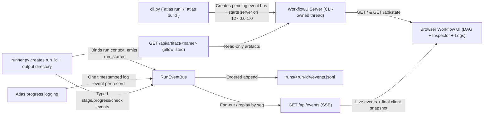
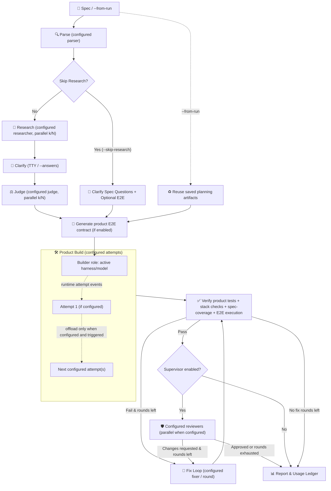

# Atlas Visual Workflow UI Plan

> **Status:** v1 implemented 2026-11-25 (see "Review and what was built" below; it lists where the code differs from this plan)
> **Related:** [ARCHITECTURE.md](../ARCHITECTURE.md) | [HARNESS_PLAN.md](HARNESS_PLAN.md) | [TESTING_AND_DEPLOYING.md](TESTING_AND_DEPLOYING.md)

---

## Review and what was built (2026-11-25)

The plan held up: loopback-only, read-only, stdlib-only, `events.jsonl` replay, terminal-owned clarification, TTY-only auto-launch, Host/Origin checks and an artifact allowlist all shipped as written. Changes made while building it against the real code:

| Plan | Built | Why |
| :--- | :--- | :--- |
| `/api/state` snapshot + `as_of_seq` cursor, then SSE | One SSE stream that replays every event from `seq` 1 (or `Last-Event-ID`) and then goes live; `event: end` when the run finishes | A run is ~1,000 events. One ordered stream removes the snapshot/subscribe race instead of managing it. |
| Optional `event_bus` passed into runner/research/judge/build/verify | Module-level `atlas.events.publish()`; a no-op unless the CLI attached a `RunEventBus` | No signature changes; library callers and existing tests are untouched. |
| 13 event kinds, each with a strict payload model | One envelope `{v, seq, ts, run_id, kind, stage, status, message, data}`; kinds `run`, `stage`, `item`, `attempt`, `check`, `round`, `reviewer`, `usage`, `workspace`, `log`; payloads redacted and size-capped | Same information, far less schema code. |
| Builder callback for workspace file events | The server polls the product folder every 2 s (`workspace_signature`, same ignore list as the builder snapshot) and publishes the file list on change | No builder hooks; works for every builder and for fix rounds. |
| `--quiet` independent of the UI | With the UI on, `--quiet` keeps the `atlas` logger at INFO and only the terminal handler at WARNING | Otherwise `--quiet` would silently empty the browser log. |
| `--ui-keep-open`, `/api/app-file/<path>`, UI for `atlas plan` | `--ui-keep-open` and opt-in `atlas plan --ui` implemented in second-pass polish; `/api/app-file/<path>` stays deferred | `atlas plan --ui` works with zero changes to existing `plan` callers; `--ui-keep-open` holds the run server alive until `Ctrl+C` while `atlas ui <run>` covers after-the-fact replay. |
| Emoji status symbols | Inline SVG stage glyphs inside transit-map station markers, with a small status badge (check, cross, !, pause, reuse) | Renders the same everywhere; reads as one system. |

Second-pass review improvements (2026-11-25): fixed in-place 1s live timer updates (no DOM wipe of open verification details/scroll), restored open `<details>` state across event updates, added `/api/info` mode badge + `Copy replay cmd`, added route completion bar + keyboard arrow navigation + research/judge gap indicators + explicit build harness labels (`Local SDK`, `Antigravity CLI`, `Claude Code`), added live stall-guard bar + updated file badges + per-stage artifact viewers + usage-by-stage breakdown in Report, redacted served artifacts, added collapsible/resizable bottom log drawer with unclipped warning/error chips, enriched legacy artifact replay (`synthesize_events`), and fixed `test_a_real_build_publishes_the_whole_flow` imports.

Shipped pieces: `src/atlas/events.py`, `src/atlas/ui/server.py`, `src/atlas/ui/static/index.html`, CLI flags `--ui/--no-ui`, `--ui-port`, `--no-open`, `--ui-keep-open` on `build`/`run`/`plan`, and `atlas ui [run_dir]` (newest run by default; runs older than `events.jsonl` are rebuilt from `manifest.json`, `spec.json`, `clarifications.json`, `plan.json`, `e2e_tests.json`, `build.json`, `verification.json`, `supervisor_review.json`, and `tokens.json`). Tests: `tests/test_ui_events.py`, `tests/test_ui_server.py`, new cases in `tests/test_cli.py`.

---

## 1. Goals & Non-Goals

### Goals

- **Zero-friction auto-launch:** Running `atlas run` or `atlas build` in an interactive local terminal automatically starts a localhost workflow dashboard and opens it in your default browser. `--no-ui` disables it; `--quiet` only suppresses terminal progress output.
- **Architecture-faithful DAG visualization:** Render Atlas's real pipeline from `spec.md` or `--from-run`: parse, optional research, clarification, optional judge, optional E2E contract generation, build using the selected configuration and its actual offload attempts, verification of the product's own tests, fix rounds, optional parallel supervisor review, and final report + usage ledger.
- **Rich status symbols & per-stage drill-down:** Each node shows a distinct role symbol, animated live state, active model/harness pill, live `k/N` progress bars (`research`, `judge`), per-check chips (`verify`), and an interactive inspector drawer for logs, Q&A clarifications, `BUILD_BRIEF.md` / generated files, check output, and supervisor verdicts.
- **Zero new runtime dependencies:** Built purely on Python stdlib (`http.server.ThreadingHTTPServer`, `webbrowser`, Server-Sent Events) plus a self-contained HTML/CSS/SVG/JS asset packaged under `src/atlas/ui/static/` — no Node build step or Electron/React runtime inside Atlas.
- **Terminal `--clarify` safety:** The browser is a read-only observer. Clarification answers remain on terminal `stdin`; UI output stays on `stderr` and never changes command `stdout`. Opening a browser may bring it to the foreground, so the plan does not promise that focus will remain in the terminal.

### Non-Goals (v1)

- No hosted web server, multi-user auth, or remote browser control.
- No Node/npm frontend toolchain or external CSS/JS CDN fetches (works 100% offline).
- Strictly **read-only observer** in v1 (no button mutations or editing files from the browser; interactive in-browser clarification answering is deferred to a possible v2 follow-up).

---

## 2. Architecture & Data Flow



Run lifecycle and ownership:
1. After CLI argument/spec-path validation, an eligible `run` / `build` creates an unbound event bus, starts the server on `127.0.0.1:<ephemeral-port>`, and opens the browser. Before a run ID exists the page shows `Starting Atlas run…`. UI startup or browser-open failure is logged to `stderr` and never prevents the build.
2. `run_plan` / `run_build` creates the run ID and output directory internally. Immediately after that, it binds the event bus to `run_id` and `runs/<run-id>/events.jsonl`, then emits `run_started` before parsing begins. This handoff is required because the CLI does not currently know the run ID before calling the runner.
3. The browser first loads a snapshot with an `as_of_seq` cursor, then subscribes to SSE after that cursor. This closes the snapshot/subscribe race. Late connections and reconnects replay persisted events after `Last-Event-ID`.
4. The event bus assigns sequence numbers and appends each JSONL record under a lock. SSE subscriber queues are bounded; a slow or disconnected browser can reconnect and replay from disk without blocking the pipeline.
5. On success or failure, the runner persists a terminal `run_finished` event and flushes the event writer. It includes a bounded materialized UI snapshot (stage/check summaries, final status, and a log cursor) so the already-open tab can show completion even if it missed earlier SSE messages. Give connected SSE clients a short bounded delivery grace (for example, 2 seconds) before closing; never wait indefinitely. The live server then closes with the CLI process. To refresh, inspect full logs/artifacts, or reopen later, run `atlas ui <run-dir>`; that replay command owns a server until `Ctrl+C`.
6. `--ui-keep-open` is an optional mode for keeping the run server and CLI process alive after completion until `Ctrl+C`. The default does not leave an orphan process. The completed snapshot must not depend on API calls after the default server has closed.
7. The CLI closes the server in `finally` on success, verification failure, setup error, exception, or `Ctrl+C`. If runner validation fails before a run context exists, close the server and report the normal CLI error without leaving a tab pointed at a live orphan.

The event bus is the source of truth for the DAG; log events are a separate view. Capture Atlas progress records once and preserve their timestamp/message/level. Add an `atlas_stage` logging field (or equivalent stage context) to Atlas log records so the UI can filter them without parsing message text. Do not infer stage state by parsing log text. Any third-party warnings shown in the terminal should either be explicitly labeled as system logs in the UI or omitted from the mirrored Atlas progress stream.

---

## 3. Visual Workflow Topology & Stage Symbols

The canvas follows [ARCHITECTURE.md](../ARCHITECTURE.md#2-end-to-end-flow-spec-input-to-appspec-name). It is **role-driven, not model-hardcoded**: labels and active attempts come from the selected config and actual runtime routing. `atlas build` with a different config may not use the local-first backend or have any offload attempts. The live view ends at the local report and usage ledger; GitHub CI/CD is not part of the `atlas run/build` process.



### Stage Symbol & Telemetry Matrix

| Stage ID | Symbol | Label | Backend / Model Pill | Primary Live Telemetry Shown on Node |
| :--- | :---: | :--- | :--- | :--- |
| `run` | 📄 | Spec / Resume | Input path and selected config | Spec slug, run ID; reused badge (`♻️`) when planning artifacts came from `--from-run` |
| `parse` | 🔍 | Parse | Actual parser harness/model from config and router call record | Requirement count (`functional` count), `open_questions`, elapsed `s` |
| `research` | 🧪 | Research | Actual researcher harness/model; show fallback when used | Live `k/N` progress bar keyed by requirement ID, notes/failures, elapsed `s` or `skipped` |
| `clarify` | 💬 | Clarify | `TTY` / `--answers` | `answered/total` questions; amber pulse while awaiting terminal input |
| `judge` | ⚖️ | Judge | Actual configured judge target (read-only where configured) | Live `k/N` progress keyed by requirement ID, selected decisions, tasks, risks |
| `e2e_tests` | 🎯 | Generate E2E contract | Actual configured E2E/researcher target (current harness profile uses `claude_code` `sonnet`, `--effort high`, read-only, fallback OpenRouter) | `verifiable: true` plus test paths, or `unverifiable` warning and reason; this is generation before build. Test execution appears under `verify`. |
| `build` | 🛠️ | Product Build | Active configured builder; show actual attempt/offload models as they run | Active attempt and elapsed time; workspace builders show changed file paths/count and stall time, structured builders show response/materialization progress |
| `verify` | ✅ | Verify | Isolated `verify_app` subprocesses | Round `R`, detected stack, actual per-check chips (e.g. `python-pytest` or Node tests, lint/build, `spec-coverage`, `product-contract`, `e2e-product-tests`) |
| `fix` | 🔧 | Fix Loop | Configured fixer and actual selected model per round. Current harness profile rotates `claude_code` Sonnet and `agy` Hydrogen (fallback OpenRouter). | Active round `k/max`, failing check names, diagnosis summary |
| `supervisor` | 🛡️ | Dual Supervisor | Configured reviewers; current harness profile uses Opus + Neon in parallel | Independent reviewer pills (`APPROVED` / `CHANGES REQUESTED`), issue count |
| `report` | 📊 | Report & Ledger | `report.md` + `usage/ledger.jsonl` | Final build status, `total_calls`, `total_tokens`, est. USD cost |

### Node Status Symbol & Color Legend

| Status | Visual Badge / Motion | Meaning |
| :--- | :---: | :--- |
| `pending` | ⚪ Muted slate border | Queued downstream stage not yet started |
| `running` | 🔵 Animated pulse ring + spinning arc + dashed active edge | Stage currently executing |
| `waiting_input` | 🟠 Amber pulse (`Waiting in terminal`) | `clarify` paused for human answers in TTY |
| `reused` | ♻️ Cyan/teal badge | Reused from `--from-run` without LLM calls |
| `skipped` | ⏭️ Dashed gray border | Skipped (e.g. `--skip-research`, `--no-e2e-tests`) |
| `partial` | 🟡 Amber badge | Stage completed with some failures or warnings, such as partial research results |
| `offloaded` | ↪️ Orange hop connector + sub-pill | A build attempt handed off to its next configured target; this describes an attempt, not the final build-stage status |
| `unverifiable` | ⚠️ Amber badge | E2E contract could not be executed offline; show the reason |
| `passed` | ✅ Crisp emerald border + check badge | Stage or verification checks passed |
| `failed` | ❌ Crimson border + alert badge | Stage errored or final verification failed |
| `cancelled` | ⏹️ Muted badge | Run stopped by user interruption |

---

## 4. UI Layout Wireframe & Interactive Controls

This wireframe illustrates the current `config/harness.yaml` local-first profile. Runs using another config display that run's actual builder, offloads, fixer, and reviewer targets instead of these example model names.

```text
+---------------------------------------------------------------------------------------------------+
|  ATLAS WORKFLOW   run: 20261125T085546Z-65fa00f1   spec: specs/example-app.md   [● LIVE]  04:18   |
|  Calls: 43   Tokens: 1,182,410   Est. Cost: $0.0420 (local: $0.00 / sub: Opus)  Status: RUNNING   |
+---------------------------------------------------------------------------------------------------+
|                                                                   |                               |
|  WORKFLOW CANVAS (SVG DAG)                                        |  STAGE INSPECTOR: BUILD (🛠️)  |
|                                                                   |  Status: RUNNING (Hop 1)      |
|   [📄 Spec] ──▶ [🔍 Parse ✅] ──▶ [🧪 Research ✅ 20/20]          |  Active: lm_studio/gemma-12b  |
|                                         │                         |  Brief: BUILD_BRIEF.md (5.1K) |
|                    ┌────────────────────┘                         |  Stall guard: 18s / 300s      |
|                    ▼                                              |                               |
|   [💬 Clarify ✅ 8/8] ──▶ [⚖️ Judge ✅ 20/20] ──▶ [🎯 E2E ✅]     |  Workspace Files (4 written): |
|                                                       │           |   • PLAN.md (pre-seeded)      |
|   ┌───────────────────────────────────────────────────┘           |   • BUILD_BRIEF.md            |
|   ▼                                                               |   • tests/test_e2e_product.py |
|  ┌──────────────────── 🛠️ PRODUCT BUILD ─────────────────────┐    |   • index.html (updating...)  |
|  │ [🖥️ Gemma 4 12B 🔵] ──↪ [☁️ Sonnet ⚪] ──↪ [⚡ Hydrogen ⚪] │    |                               |
|  └───────────────────────────────────────────────────────────┘    |  Sub-events:                  |
|            │                                                      |   [10:56:28] Selected 12B     |
|            ▼                                                      |   [10:56:50] Wrote index.html |
|   [✅ Verify R1 ⚪] ◀──── [🔧 Fix ⚪] ◀──── [🛡️ Supervisor ⚪]     |                               |
|        │                                          │               |                               |
|        └───────────────────────▶ [📊 Report ⚪] ◀──┘               |                               |
+---------------------------------------------------------------------------------------------------+
|  LIVE LOGS   [All] [parse] [research] [clarify] [judge] [e2e] [build] [verify] [fix] [supervisor] |
|  Search logs... [________________]   Level: [All v]   [x] Auto-scroll   [Copy Logs]               |
|  [10:55:46] [build] Prepared workspace app/example-app (BUILD_BRIEF.md=True, e2e_files=1)         |
|  [10:56:28] [build] Selected local model lm_studio/google/gemma-4-12b-qat — starting agent...     |
+---------------------------------------------------------------------------------------------------+
```

### Interactive Features
- **Click any node** to open the right-hand **Stage Inspector** showing:
  - `research` / `judge`: per-requirement `R001..R020` table with status, chosen pick, and elapsed time.
  - `clarify`: question/answer list plus an amber notice whenever Atlas is waiting on terminal input.
  - `build`: active configured attempt, `BUILD_BRIEF.md` preview when present, file-change list and stall countdown for workspace builders. A watcher emits bounded path/timestamp events, not whole file contents. Structured builders show response and materialization progress instead of a live workspace file list.
  - `verify` / `fix`: round tabs (`R1`, `R2`, ...), `[PASS]` / `[FAIL]` check pills, capped failing `stdout`/`stderr` tails, and fix diagnosis.
  - `supervisor`: side-by-side `Opus` and `Neon` cards with verdicts, merged issues, and ordered improvement plan.
- **Filterable Live Log Drawer:** Mirrors Atlas progress messages with their existing `[HH:MM:SS]` timestamps, with one-click filtering by stage, level (`INFO` / `WARNING` / `ERROR`), substring search, auto-scroll pause on upward scroll, and copy-to-clipboard. System/dependency logs, if included, are labeled separately. Logs are redacted and length-capped before persistence and display.
- After the live server closes, the loaded page can filter and inspect event data already in memory. Loading additional artifacts or refreshing uses `atlas ui <run-dir>` to start replay mode.

---

## 5. CLI Flags, Auto-Launch Rules & Standalone Replay

### Auto-Launch Rules (`atlas run` / `atlas build`)
- **Enabled by default (`--ui` auto)** when ALL of the following hold:
  1. `sys.stderr.isatty()` is `True` (interactive local terminal; UI notices are written to stderr),
  2. Neither `CI` nor `GITHUB_ACTIONS` environment variables are truthy,
  3. The command is `atlas run` or `atlas build`.
- **Disabled automatically** in CI workflows, piped shell scripts, and automated tests (`pytest`) so headless runs remain fast and side-effect-free.
- `--quiet` only suppresses terminal progress lines; `--no-ui` is the explicit UI opt-out. `--ui` can force the UI on in non-interactive use. If `webbrowser.open()` fails or no browser is available, Atlas prints the URL and continues the run.
- Browser launch can foreground the browser. It does not change which terminal owns `stdin`, so `--clarify` answers are still typed in Terminal.

### CLI Options

| Command / Flag | Default | Behavior |
| :--- | :--- | :--- |
| `--ui` / `--no-ui` (`plan`, `build`, `run`) | `build`/`run`: TTY auto; `plan`: `False` | Explicitly force-enable or disable the workflow UI server. |
| `--ui-port <int>` | `0` (ephemeral free localhost port) | Pin a specific `127.0.0.1` port if desired. |
| `--no-open` | `False` | Start the UI server and print its `http://127.0.0.1:<port>` URL to `stderr` without calling `webbrowser.open(...)`. |
| `--ui-keep-open` | `False` | After run completion, keep the CLI/server alive until `Ctrl+C` so the browser can continue requesting artifacts. |
| `atlas ui [runs/<run-id>]` | Newest run under `runs/` | Start replay mode for a past or in-progress run (reads `events.jsonl`, or synthesizes state from `manifest.json`, `verification.json`, `supervisor_review.json`, and `tokens.json` for older runs). The command remains active until `Ctrl+C` so the browser can request state and artifacts. |

All CLI UI announcements go strictly to `stderr` (`[HH:MM:SS] [ui] Live workflow UI: http://127.0.0.1:<port>`), keeping `stdout` untouched.

---

## 6. Event Schema, Persistence & Read-Only Local API

### Structured Event Contract (`src/atlas/events.py`)

`RunEvent` is a strict Pydantic model (`StrictModel`). Use an enum for `stage`, `kind`, and `status`, and validate each event kind's payload with a strict kind-specific model before serializing it. `data` below illustrates the envelope; it is not an unvalidated arbitrary dictionary in the implementation.

```python
class RunEvent(StrictModel):
    schema_version: Literal[1]
    seq: int
    ts: str                      # UTC ISO-8601 timestamp
    run_id: str
    stage: Literal["run", "parse", "research", "clarify", "judge", "e2e_tests", "build", "verify", "fix", "supervisor", "report"]
    kind: Literal[
        "run_started",
        "stage_status",
        "stage_progress",
        "clarify_waiting",
        "build_attempt",
        "build_offload",
        "workspace_file",
        "verification_check",
        "verify_round",
        "reviewer_verdict",
        "telemetry_update",
        "log",
        "run_finished",
    ]
    status: Literal["pending", "running", "waiting_input", "reused", "skipped", "partial", "unverifiable", "passed", "failed", "cancelled"] | None = None
    message: str = ""
    data: dict[str, Any] = Field(default_factory=dict)  # validated by `kind`; includes correlation fields
```

Progress payloads carry stable correlation fields such as `requirement_id`, `round`, `attempt`, `reviewer`, `check_name`, `completed`, and `total`. The view uses these to render concurrent research/judge results and repeated verify/fix rounds without relying on event arrival order. `offloaded` belongs to a build-attempt event; the build stage remains `running` until it completes or fails.

### Persistence (`runs/<run-id>/events.jsonl`)
- Every emitted `RunEvent` receives a monotonic sequence number and is appended as one JSON line under the bus lock to `runs/<run-id>/events.jsonl`; flush the writer before process exit.
- Refreshing the browser mid-run or opening `atlas ui runs/<run-id>` later reconstructs the exact stage timeline, progress bars, offload history, and log stream.
- The server binds only to loopback, validates the `Host` and `Origin`, sends no permissive CORS headers, exposes no write routes, and serves only the selected run's allowlisted artifacts. Scrub secrets and cap event/log/artifact payloads; generated source is shown only after an explicit file selection with paths confined to the run's `app_dir`.

### Read-Only HTTP & SSE Endpoints (`127.0.0.1` only)

| Method & Path | Response Type | Purpose & Safety |
| :--- | :--- | :--- |
| `GET /` | `text/html; charset=utf-8` | Serves self-contained `src/atlas/ui/static/index.html` dashboard. |
| `GET /api/state` | `application/json` | Materialized state snapshot plus `as_of_seq` cursor (also loads `events.jsonl` / supported legacy artifacts in replay mode). |
| `GET /api/events?after=<seq>` | `text/event-stream` | Live Server-Sent Events stream with `Last-Event-ID` catch-up, bounded subscriber queues, and 15s keepalive heartbeats. Reconnect replay fills any queue gap. |
| `GET /api/artifact/<name>` | `application/json` or `text/markdown` | Strict allowlist only: `manifest.json`, `spec.json`, `research.json`, `clarifications.json`, `plan.json`, `plan.md`, `e2e_tests.json`, `build.json` summary, `verification.json`, `supervisor_review.json`, `tokens.json`, `report.md`. Rejects traversal and never serves `.env` or files outside the selected run. Full generated files use a separate read-only route with relative-path validation under the manifest's `app_dir`, explicit file selection, and a response-size cap. |
| `GET /api/app-file/<relative-path>` | `text/plain` or safe text type | Reads only an explicitly selected file under the run manifest's `app_dir`; rejects traversal/symlink escape and caps response size. No directory listing or write route. |

---

## 7. Phased Implementation Plan

### Phase 1 — Structured Event Bus & Pipeline Hooks
- Add `src/atlas/events.py` (`RunEvent`, `RunEventBus`, `AtlasLogHandler`, `load_events_jsonl`, and `synthesize_state_from_run_dir` fallback for pre-UI runs).
- Bind the bus immediately after `run_plan` / `run_build` creates `run_id` and `out`; emit `run_started` before the first stage. Keep optional `event_bus` hooks so existing library callers remain unaffected.
- Instrument `runner.py` (`run_plan`, `run_build`, `_run_clarifications`), `research.py` and `judge.py` (correlated `k/N` item progress), `build.py` (configured attempts/offloads, actual target/model, supervisor verdicts), and `verify.py` (round and per-check results).
- Emit workspace file-change events from an explicit watcher or builder callback so the file list and stall timer have a real data source. Do not send full file contents as progress events; ignore paths outside the app workspace and do not follow symlinks outside it.
- The event writer and subscriber fan-out must not block model/pipeline work on a slow browser. Persist in sequence order; flush the final event before shutdown. A disconnected/slow client recovers from JSONL by event sequence.
- Existing callers and tests passing no `event_bus` see zero behavioral change.

### Phase 2 — Local HTTP/SSE Server & Self-Contained Visual Dashboard
- Add `src/atlas/ui/__init__.py`, `src/atlas/ui/server.py` (stdlib `ThreadingHTTPServer` bound strictly to `127.0.0.1`, bounded SSE queues, allowlisted artifact handler, clean shutdown after `run_finished`), and `src/atlas/ui/static/index.html` (embedded CSS, interactive SVG DAG canvas, consistent inline SVG/status symbols, inspector drawer, filtered live log console, dark/light theme support).
- Update `pyproject.toml` `[tool.setuptools.package-data]` to include `atlas = ["prompts/*.md", "ui/static/*"]`.
- Validate `Host` / `Origin`, disable CORS, serve no write endpoints, and bound/redact data returned from logs and artifacts. The API is scoped to one run at a time.

### Phase 3 — CLI Auto-Launch & `atlas ui` Replay Subcommand
- Update `src/atlas/cli.py` to auto-launch on interactive `build` / `run`, add `--ui` / `--no-ui`, `--ui-port`, `--no-open`, and add `atlas ui [run_dir]` replay (`--runs-root`, `--port`, `--no-open`). `plan` remains opt-in via `--ui`.
- `--quiet` affects only terminal progress output. UI startup/browser failures produce a warning and the build continues; `--ui` can force launch, while CI/non-interactive defaults remain headless.

### Phase 4 — Offline Tests & Documentation
- Add `tests/test_ui_events.py` (event ordering, `events.jsonl` persistence/replay, `AtlasLogHandler`, fallback synthesis from `manifest.json`) and `tests/test_ui_server.py` (`ThreadingHTTPServer` ephemeral port bind, `/api/state`, live SSE delivery + `Last-Event-ID`, `/api/artifact/` allowlist & traversal rejection, clean shutdown).
- Extend `tests/test_cli.py` for TTY auto-launch vs CI suppression, quiet/UI independence, `--no-ui` / `--no-open`, browser-open failure fallback, and `atlas ui` lifecycle.
- Cover concurrent/out-of-order research and judge events, verify rounds and check results, partial/unverifiable states, dynamic builder/offload targets, replay after run exit, browser disconnect/reconnect without event loss, early CLI failures/`Ctrl+C` cleanup, and loopback/security guards.
- Verify the packaged wheel includes the self-contained UI asset; retain a manual browser visual check because server-unit tests cannot validate browser layout/accessibility.
- Update `README.md`, `ARCHITECTURE.md`, and `docs/TESTING_AND_DEPLOYING.md`.

---

## 8. Verification & Testing Strategy

1. **Automated Offline Verification (`0` LLM tokens):**
   - `ruff check .` clean (<= 100 chars line length, E/F/I/UP/B).
   - `mypy src/ --ignore-missing-imports` clean across all modules.
   - `pytest -q` passes the current full framework suite plus the new UI tests. Do not pin a test count in this plan; use the suite's current collected count. Include thread cleanup checks so tests leave no server sockets or child processes running.
2. **Live Visual Check on Your Machine:**
   - Replay an existing run immediately (`0` tokens):
     `atlas ui runs/<run-id>`
   - Run `atlas run specs/example-app.md --config config/harness.yaml` in a local interactive terminal and confirm the browser opens automatically, then replay the resulting run after CLI exit to verify the final artifacts load.
   - Confirm the dashboard shows the actual model/harness and any runtime fallback/offload, product test/E2E check results, fix rounds, supervisor result, and honest cost/auth metadata.
   - Verify terminal clarification still reads from `stdin` and that stdout remains unchanged. The browser can foreground on launch; the user may switch back to Terminal to answer.

---

## 9. Decisions Locked for V1

1. **Auto-launch:** `atlas run` and `atlas build` auto-launch the UI in an interactive local terminal. `atlas plan` is opt-in. `--no-ui` disables the UI; `--quiet` does not.
2. **Clarifications:** Keep answers on the terminal in v1. The browser shows `Waiting for your answer in Terminal`; it does not intercept input.
3. **Server lifetime:** The run server lives only with the `atlas run/build` process by default. On finish, the browser keeps a client-side completed snapshot; use `atlas ui <run-dir>` to refresh, reopen, or load additional artifacts. `--ui-keep-open` is an explicit opt-in that keeps the CLI/server alive until `Ctrl+C`.
4. **Theme:** Use system dark/light preference with a visible theme toggle. This is a presentation detail and does not block the event/schema work.
